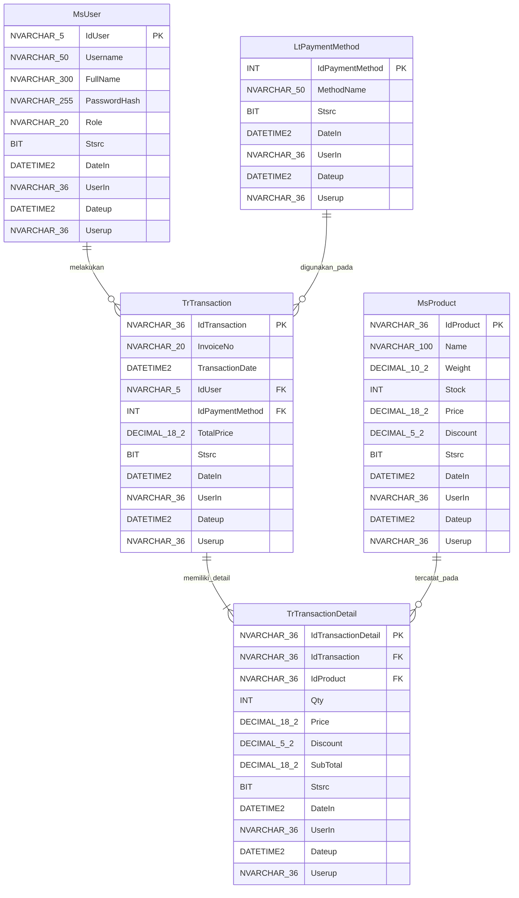

# Product Requirements Document (PRD) — Binus Point of Sale (POS) Web App: BeeMart

---
## 1. Overview

### 1.1 Project Identity & Purpose
- **Project Name**: Binus Point of Sale (POS) Web App: BeeMart (`BeeMart System`) *(PDF Hal. 1)*
- **Context**: `.NET C# IT BOOTCAMP TEST 2026/2027` — Proyek aplikasi dari **IT Division** *(PDF Hal. 1)*
- **Purpose**: Membangun platform Sistem Kasir (Point of Sale / POS) terintegrasi menggunakan bahasa **C#** pada framework **.NET 8** dengan arsitektur **Separation of Concerns**, di mana sistem dipisah menjadi dua proyek utama: **WebClient (Frontend/UI)** dan **Backend API** *(PDF Hal. 1)*.
- **Architectural Principle**: **WebClient** hanya bertindak sebagai *consumer* (pengonsumsi) data. Seluruh proses bisnis, logika aplikasi, dan persistensi/penyimpanan data dikelola secara terpusat di **Backend API** *(PDF Hal. 1)*.

### 1.2 Tujuan Pembelajaran (Learning Objectives) *(PDF Hal. 1–2)*
1. **Arsitektur Sistem**: Mempraktikkan arsitektur *Separation of Concerns* (Pemisahan antara UI dan API).
2. **Integrasi API**: Mendesain dan mengonsumsi RESTful API untuk fitur autentikasi, master produk, pembuatan transaksi, dan pelaporan riwayat transaksi.
3. **State Management**: Mengelola *state* pada sisi WebClient (seperti data kasir yang *login*, *state* keranjang belanja/*cart*, dan *state* pencarian barang).
4. **Keamanan & Validasi**: Menerapkan validasi input data di sisi klien maupun server, serta menerapkan kontrol akses otorisasi (*Role-based Authorization*).
5. **Desain Database**: Merancang dan mengelola relasi data (*Entity Relationship Diagram / ERD*) menggunakan relasi tabel `User` (`MsUser`), `Product` (`MsProduct`), `Transaction` (`TrTransaction`), dan `TransactionDetail` (`TrTransactionDetail`), beserta `LtPaymentMethod` *(PDF Hal. 2, 4)*.

### 1.3 Target Users
- **Kasir (`Cashier`)**: Staf kasir yang mengoperasikan transaksi penjualan barang dan melihat riwayat transaksinya sendiri *(PDF Hal. 1, 5, 7, 11)*.
- **Admin (`Admin`)**: Pengelola/administrator yang dapat melakukan transaksi penjualan barang serta memantau seluruh riwayat transaksi dari semua Kasir *(PDF Hal. 1, 5, 7, 11–12)*.

### 1.4 Scope & Out-of-Scope
#### In-Scope *(PDF Hal. 1–12)*:
1. **Login**: Autentikasi dan otorisasi pengguna dengan *Username*, *Password* (*hashed*), dan *Dropdown Role* (`Admin` / `Kasir` [`Cashier`]) *(PDF Hal. 1, 5)*.
2. **Register**: Pendaftaran akun pengguna baru (*Username*, *Full Name*, *Password*, *Re-Password*, *Role*) dengan *hashing password* dan validasi keunikan *username* *(PDF Hal. 1, 6)*.
3. **New Transaction**:
   - Header menampilkan jam *real-time* dan nama kasir yang sedang *login* serta tombol `Logout` *(PDF Hal. 1, 7–10)*.
   - Generasi `Invoice Number` (`InvoiceNo`) otomatis berformat `[5 digit userID][ddmmyy][3 digit running number]` yang tidak dapat diedit oleh *user* *(PDF Hal. 1, 7–10)*.
   - Pencarian barang dari database (maksimal 10 data dengan nama serupa kata kunci) *(PDF Hal. 1, 7–8)*.
   - Pemilihan barang (`Pilih`) dengan kotak dialog informasi barang, harga satuan, sisa stok, dan input `Qty` beserta validasi terhadap sisa stok (`Masukkan ke Keranjang`) *(PDF Hal. 8–9)*.
   - Pengelolaan `Daftar Belanjaan` (keranjang belanja/*cart*), hapus item (`Hapus`), kalkulasi `Subtotal` per item dan `Total` harga transaksi *(PDF Hal. 1, 7–10)*.
   - Pemilihan `Metode Pembayaran` (`Cash`, `Debit`, `Credit`) yang di-*fetch* secara dinamis menggunakan API dari tabel `LtPaymentMethod` *(PDF Hal. 1, 4, 9)*.
   - Submit transaksi (`Submit Transaksi`) dan *reset* halaman otomatis beserta pembuatan `Invoice Number` baru untuk transaksi berikutnya *(PDF Hal. 10)*.
4. **History Transaction (Role: Kasir)**:
   - Filter riwayat transaksi berdasarkan tanggal (`date picker` wajib dipilih), hanya menampilkan transaksi milik kasir yang sedang *login*, diurutkan *Ascending* berdasarkan Tanggal dan Jam transaksi, dengan *Pagination* maksimal 20 data per halaman *(PDF Hal. 1, 2, 11)*.
5. **History Transaction (Role: Admin)**:
   - Filter riwayat transaksi berdasarkan tanggal (`date picker` wajib dipilih), menampilkan seluruh riwayat transaksi dari semua kasir, diurutkan *Ascending* berdasarkan Tanggal dan Jam transaksi, dengan *Pagination* maksimal 20 data per halaman *(PDF Hal. 1, 2, 11–12)*.
6. **Database & Seeding Script**:
   - Implementasi 5 tabel sesuai ERD (`MsUser`, `LtPaymentMethod`, `MsProduct`, `TrTransaction`, `TrTransactionDetail`) di SQL Server menggunakan EF Core, disertai script `.sql` berisi DDL (`CREATE TABLE`) dan DML (*Seeding* produk, metode pembayaran, dan user) *(PDF Hal. 2–4)*.

#### Out-of-Scope (Tidak Disebutkan di PDF):
- Halaman CRUD Manajemen Master Produk (`MsProduct`) melalui UI (produk di-*seed* melalui script SQL DML).
- Halaman CRUD Manajemen Metode Pembayaran (`LtPaymentMethod`) melalui UI.
- Halaman Edit Profil / Ubah Password / Lupa Password.
- Pembatalan (*Void* / *Refund*) atau pengeditan transaksi yang sudah di-*submit*.
- Cetak struk fisik (*Print Receipt* / PDF Export).

### 1.5 Glossary of Domain Terms *(Sesuai Istilah Asli PDF)*
| Term (Istilah Asli PDF) | Definisi / Penggunaan dalam Sistem | Sumber PDF |
| :--- | :--- | :--- |
| **BeeMart / BeeMart System** | Nama aplikasi Point of Sale (POS) Web App yang dibangun. | Hal. 1 |
| **WebClient (Frontend/UI)** | Proyek antarmuka pengguna yang hanya bertindak sebagai *consumer* data melalui HTTP Request ke Backend API. | Hal. 1, 2 |
| **Backend API** | Proyek ASP.NET Core API (.NET 8) tempat seluruh proses bisnis, logika aplikasi, dan akses database SQL Server melalui EF Core berada. | Hal. 1, 2 |
| **Admin** | Role pengguna dengan `Name: "Admin"`, `Value: "Admin"` yang dapat mengakses *New Transaction* dan melihat *History Transaction* seluruh kasir. | Hal. 1, 5, 7, 11 |
| **Kasir / Cashier** | Role pengguna dengan tampilan label dropdown `Name: "Kasir"` dan nilai `Value: "Cashier"` yang dapat mengakses *New Transaction* dan melihat *History Transaction* miliknya sendiri. | Hal. 1, 5, 7, 11 |
| **Invoice Number / Invoice No / InvoiceNo** | Nomor unik transaksi berformat baku `[5 digit userID][ddmmyy][3 digit running number]` (contoh: `76985040926001`). | Hal. 1, 4, 7, 10 |
| **Daftar Belanjaan** | Tabel keranjang belanja (*cart*) pada halaman *New Transaction* yang memuat barang yang dipilih beserta `Harga`, `Diskon`, `Qty`, `Subtotal`, dan tombol `Hapus`. | Hal. 7, 8, 9, 10 |
| **Barang Terpilih** | Kotak dialog/panel pada halaman *New Transaction* yang muncul setelah tombol `Pilih` diklik pada tabel hasil pencarian barang. | Hal. 9 |
| **Metode Pembayaran** | Pilihan cara pembayaran transaksi (`Cash`, `Debit`, `Credit`) yang diambil secara dinamis dari API (`LtPaymentMethod`). | Hal. 1, 4, 9 |
| **History Transaction / Riwayat Transaksi** | Menu/halaman untuk melihat data transaksi yang ditarik dari tabel transaksi berdasarkan filter tanggal yang dipilih pengguna. | Hal. 1, 11, 12 |
| **Stsrc** | Kolom bertipe `BIT` pada seluruh tabel database (`MsUser`, `LtPaymentMethod`, `MsProduct`, `TrTransaction`, `TrTransactionDetail`) sebagai penanda status record (*status record* / aktif). | Hal. 4 |
| **DateIn / UserIn / Dateup / Userup** | Kolom *audit trail* standar pada seluruh tabel database di ERD untuk mencatat waktu dan pengguna pembuat (`DateIn`, `UserIn`) serta pengubah (`Dateup`, `Userup`). | Hal. 4 |

---

## 2. User Roles & Permissions

### 2.1 Role Definitions *(PDF Hal. 1, 5, 7, 11, 12)*
| Role Label (UI Dropdown Name) | Role Value (System/DB Value) | Deskripsi | Sumber PDF |
| :--- | :--- | :--- | :--- |
| **Tidak Login (Anonymous / Guest)** | - | Pengguna yang belum terautentikasi. Hanya dapat mengakses halaman `Login` dan `Register`. | Hal. 5, 6 |
| **Kasir** | `Cashier` | Pengguna kasir yang dapat melakukan transaksi penjualan baru dan hanya dapat melihat riwayat transaksinya sendiri. | Hal. 1, 5, 7, 11 |
| **Admin** | `Admin` | Pengguna administrator yang dapat melakukan transaksi penjualan baru dan dapat melihat seluruh riwayat transaksi dari semua kasir. | Hal. 1, 5, 7, 11, 12 |

### 2.2 Access Matrix per Feature *(PDF Hal. 1, 5–12)*
| Fitur / Menu / Aksi | Guest (Belum Login) | Kasir (`Cashier`) | Admin (`Admin`) | Sumber PDF |
| :--- | :---: | :---: | :---: | :--- |
| **Halaman Login** | Mengakses & Submit | Redirect ke App / Logout terlebih dahulu | Redirect ke App / Logout terlebih dahulu | Hal. 5 |
| **Halaman Register** | Mengakses & Submit | Redirect ke App / Logout terlebih dahulu | Redirect ke App / Logout terlebih dahulu | Hal. 6 |
| **Tombol Logout** | Tidak Tersedia | Tersedia di Header | Tersedia di Header | Hal. 7–12 |
| **Menu New Transaction** | Ditolak (Wajib Login) | Diizinkan (Penuh) | Diizinkan (Penuh) | Hal. 1, 7 |
| **Generate Invoice Number Otomatis** | Ditolak | Diizinkan | Diizinkan | Hal. 1, 7, 10 |
| **Cari Barang (Maks. 10 Data)** | Ditolak | Diizinkan | Diizinkan | Hal. 1, 7, 8 |
| **Pilih Barang & Input Qty ke Keranjang** | Ditolak | Diizinkan | Diizinkan | Hal. 8, 9 |
| **Hapus Item dari Daftar Belanjaan** | Ditolak | Diizinkan | Diizinkan | Hal. 9 |
| **Fetch Dropdown Metode Pembayaran** | Ditolak | Diizinkan | Diizinkan | Hal. 9 |
| **Submit Transaksi** | Ditolak | Diizinkan | Diizinkan | Hal. 1, 10 |
| **Menu History Transaction (Hanya Transaksi Sendiri)** | Ditolak | Diizinkan (`Hanya Kasir: <username>`) | - (Menggunakan mode Semua Kasir) | Hal. 1, 11 |
| **Menu History Transaction (Semua Kasir)** | Ditolak | Ditolak (Tidak boleh melihat transaksi kasir lain) | Diizinkan (`Menampilkan Semua Kasir`) | Hal. 1, 2, 11, 12 |

---

## 3. Feature List (Summary Table)

| Feature ID | Feature Name | Roles Involved | Priority | PDF Source |
| :--- | :--- | :--- | :--- | :--- |
| **FEAT-AUTH-01** | **Login** | Guest, `Admin`, `Cashier` | Mandatory | Hal. 1, 2, 5 |
| **FEAT-AUTH-02** | **Register** | Guest (`Admin`, `Cashier`) | Mandatory | Hal. 1, 2, 6, 7 |
| **FEAT-AUTH-03** | **Session Header, Real-Time Clock & Logout** | `Admin`, `Cashier` | Mandatory | Hal. 1, 2, 7–12 |
| **FEAT-TRX-01** | **New Transaction — Auto Invoice Number, Search Product, Cart & Submit** | `Admin`, `Cashier` | Mandatory | Hal. 1, 2, 7, 8, 9, 10 |
| **FEAT-HIST-01** | **Riwayat Transaksi (Role: Kasir)** | `Cashier` | Mandatory | Hal. 1, 2, 11 |
| **FEAT-HIST-02** | **Riwayat Transaksi (Role: Admin)** | `Admin` | Mandatory | Hal. 1, 2, 11, 12 |

---

## 4. Functional Requirements (Per Feature/Module)

---

### 4.1 Feature 1: Login (`FEAT-AUTH-01`)

- **ID & Name**: `FEAT-AUTH-01` — Login *(PDF Hal. 1, 5)*
- **Description**: Halaman ini berfungsi sebagai gerbang utama untuk proses autentikasi dan otorisasi pengguna sebelum mereka dapat mengakses fitur-fitur di dalam aplikasi *(PDF Hal. 5)*.
- **User Story**: Sebagai pengguna (`Admin` atau `Kasir`), saya ingin masuk (*Login*) ke dalam BeeMart dengan *Username*, *Password*, dan *Role* saya, sehingga saya dapat mengakses halaman transaksi dan riwayat transaksi sesuai hak akses peran saya *(PDF Hal. 1, 5)*.

#### Business Rules (`FEAT-AUTH-01`)
1. **`FR-AUTH-001`** *(PDF Hal. 5, 1.a)*: Field `Username` dan `Password` wajib diisi.
2. **`FR-AUTH-002`** *(PDF Hal. 5, 1.b)*: Kombinasi `Username`, `Password`, dan `Role` harus divalidasi dengan data pada tabel `MsUser` (hanya untuk record aktif `Stsrc = 1`).
3. **`FR-AUTH-003`** *(PDF Hal. 5, 1.c)*: Pencocokan *password* harus menggunakan metode *hashing*. *Password* yang disimpan di dalam database (`MsUser.PasswordHash`) tidak boleh berupa teks murni (*plain text*).
4. **`FR-AUTH-004`** *(PDF Hal. 5, 1.d)*: Jika `username`, `password`, atau `role` tidak sesuai, sistem harus mengembalikan pesan *error* persis: `"Invalid login"`.
5. **`FR-AUTH-005`** *(PDF Hal. 5, 1.e)*: *Dropdown* `Role` harus memiliki pilihan data tepat sebagai berikut:
   - i. Name: `"Admin"`, Value: `"Admin"`
   - ii. Name: `"Kasir"`, Value: `"Cashier"`

#### Frontend (FE) Requirements (`FEAT-AUTH-01`)
- **`FE-AUTH-001`** *(PDF Hal. 5, Mockup)*: Menampilkan halaman/komponen kartu terpusat bertajuk **"BeeMart Login"**.
- **`FE-AUTH-002`** *(PDF Hal. 5, Mockup)*: Form fields pada halaman Login:

| Field Label | Field Name | Input Type | Required? | Validation | Default Value | Error Message | PDF Source |
| :--- | :--- | :--- | :---: | :--- | :--- | :--- | :--- |
| **Username** | `username` | Text Input | Yes | Tidak boleh kosong (`!string.IsNullOrWhiteSpace`) | `""` | Pesan wajib isi / `"Invalid login"` jika gagal validasi | Hal. 5 (1.a, 1.d) |
| **Password** | `password` | Password Input | Yes | Tidak boleh kosong (`!string.IsNullOrWhiteSpace`) | `""` | Pesan wajib isi / `"Invalid login"` jika gagal validasi | Hal. 5 (1.a, 1.d) |
| **Role** | `role` | Select / Dropdown | Yes | Pilihan hanya: Name `"Admin"` (Value `"Admin"`), Name `"Kasir"` (Value `"Cashier"`) | `"Cashier"` (Tampil: `"Kasir"` sesuai gambar mockup Hal. 5) | `"Invalid login"` jika tidak sesuai data `MsUser` | Hal. 5 (1.b, 1.d, 1.e) |

- **`FE-AUTH-003`** *(PDF Hal. 2, 5)*: UI Behavior:
  - Tombol submit utama bertuliskan **`Login`** (warna biru penuh sesuai mockup Hal. 5).
  - Di bawah tombol `Login`, terdapat tautan teks **`Belum punya akun? Register`** yang mengarahkan pengguna ke halaman `Register` (`/Register` atau `/Auth/Register`).
  - Saat terjadi *error* (input kosong atau respons API gagal), tampilkan pesan *error* yang informatif menggunakan UI Popup Message (Toast / Alert / Windows Alert) atau Label Message *(PDF Hal. 2)*, khususnya menampilkan `"Invalid login"` apabila kombinasi tidak sesuai *(PDF Hal. 5, 1.d)*.
  - Saat login berhasil, simpan *state* pengguna yang login (`IdUser`, `Username`, `FullName`, `Role`, serta token autentikasi) di sisi WebClient *(PDF Hal. 1, Tujuan Pembelajaran 3)* dan arahkan (*redirect*) ke halaman **New Transaction** *(PDF Hal. 7)*.
- **`FE-AUTH-004`** *(PDF Hal. 5)*: Role-based visibility: Halaman Login dapat diakses publik (tanpa login).

#### Backend (BE) Requirements (`FEAT-AUTH-01`)
- **`BE-AUTH-001`** *(PDF Hal. 1, 2, 5)*: Endpoint Login:

| Method | URL | Auth Required | Allowed Roles | Request Body | Success Response | Error Responses |
| :--- | :--- | :---: | :--- | :--- | :--- | :--- |
| `POST` | `/api/v1/auth/login` | No | Public | `{ "username": "string", "password": "string", "role": "Admin\|Cashier" }` | `200 OK` berisi data user (`idUser`, `username`, `fullName`, `role`) & token JWT/session | `400 Bad Request` (jika Username/Password kosong), `401 Unauthorized` `{ "message": "Invalid login" }` |

- **`BE-AUTH-002`** *(PDF Hal. 5)*: Server-side validation & processing steps (secara berurutan):
  1. Validasi apakah `username` dan `password` telah diisi (tidak kosong/whitespace). Jika kosong, kembalikan `400 Bad Request`.
  2. Cari record pengguna di tabel `MsUser` berdasarkan `Username == request.Username` dan `Stsrc == true` (`1`).
  3. Jika user tidak ditemukan, kembalikan `401 Unauthorized` dengan pesan `"Invalid login"`.
  4. Verifikasi `request.Password` terhadap `MsUser.PasswordHash` menggunakan fungsi verifikasi *hash* (misal BCrypt / SHA-256 / ASP.NET Core `PasswordHasher`). Jika tidak cocok, kembalikan `401 Unauthorized` dengan pesan `"Invalid login"`.
  5. Periksa apakah `MsUser.Role == request.Role` (nilai `"Admin"` atau `"Cashier"`). Jika tidak cocok, kembalikan `401 Unauthorized` dengan pesan `"Invalid login"`.
  6. Jika seluruh validasi lolos, buat token otorisasi (misal JWT Token yang memuat klaim `IdUser`, `Username`, `FullName`, `Role`) dan kembalikan respons sukses `200 OK`.

#### Database Requirements (`FEAT-AUTH-01`)
- **`DB-AUTH-001`** *(PDF Hal. 4, 5)*: Membaca (*SELECT*) tabel `MsUser` pada kolom `IdUser`, `Username`, `FullName`, `PasswordHash`, `Role`, `Stsrc`.

#### Contoh Penerapan Fungsi (`FEAT-AUTH-01`)
- *Berdasarkan Mockup & Spesifikasi PDF Hal. 5 & 7*:
  - Pilihan Dropdown Role di UI menampilkan teks `"Kasir"` dengan value `"Cashier"`, atau `"Admin"` dengan value `"Admin"`.
  - Jika user `steven` login dengan Role `Kasir` (`Value: "Cashier"`), dan kombinasi `Username`, `PasswordHash`, serta `Role` cocok pada `MsUser`, user masuk ke halaman `New Transaction` dengan tampilan header `Kasir: steven` *(PDF Hal. 7)*.
  - Jika salah satu dari `username`, `password`, atau `role` tidak sesuai, sistem menampilkan pesan error `"Invalid login"` *(PDF Hal. 5)*.

#### Acceptance Criteria (`FEAT-AUTH-01`)
- **Happy Path**:
  - **Given** pengguna berada di halaman `BeeMart Login` dan akun `steven` terdaftar di `MsUser` dengan `Role = "Cashier"`
  - **When** pengguna mengisi `Username = "steven"`, `Password` yang benar, memilih `Role = "Kasir"` (`Value: "Cashier"`), dan menekan tombol `Login`
  - **Then** Backend API memvalidasi hash password dan role, mengembalikan status `200 OK`, serta WebClient menyimpan sesi login dan mengarahkan pengguna ke halaman `New Transaction`.
- **Validation Failure (Empty Fields)**:
  - **Given** pengguna berada di halaman `BeeMart Login`
  - **When** pengguna mengosongkan `Username` atau `Password` dan menekan tombol `Login`
  - **Then** sistem menolak proses login dan menampilkan pesan error bahwa `Username` dan `Password` wajib diisi.
- **Permission / Credential Failure (Wrong Username, Password, or Role)**:
  - **Given** pengguna berada di halaman `BeeMart Login` dan akun `steven` memiliki `Role = "Cashier"`
  - **When** pengguna memasukkan password yang salah ATAU memilih `Role = "Admin"` lalu menekan tombol `Login`
  - **Then** sistem mengembalikan dan menampilkan pesan error `"Invalid login"` melalui UI Popup Message atau Label Message.

---

### 4.2 Feature 2: Register (`FEAT-AUTH-02`)

- **ID & Name**: `FEAT-AUTH-02` — Register *(PDF Hal. 1, 6, 7)*
- **Description**: Halaman untuk mendaftarkan akun pengguna baru sebagai `Admin` atau `Kasir` (`Cashier`) ke dalam tabel `MsUser` *(PDF Hal. 1, 6, 7)*.
  > *Catatan Ketertelusuran PDF*: Poin validasi `a`, `b`, dan `c` pada halaman 7 di bawah judul `3. New Transaction` adalah pengulangan teks validasi `Register` dari halaman 6 (`a. Username, Full Name, Password, dan Re-Password wajib diisi`, `b. Password yang disimpan ke dalam database harus di-hash terlebih dahulu`, `c. Username yang didaftarkan tidak boleh duplikat (harus unik). Jika username sudah terdaftar, sistem harus mengembalikan pesan error "Username already exists"`). Seluruh aturan dari Hal. 6 dan Hal. 7 (3.a–3.c) dicakup secara utuh di fitur Register ini.
- **User Story**: Sebagai pengguna baru, saya ingin mendaftarkan akun baru (*Register*) dengan mengisi *Username*, *Full Name*, *Password*, *Re-Password*, dan memilih *Role*, sehingga saya memiliki akun untuk login ke aplikasi BeeMart *(PDF Hal. 1, 6)*.

#### Business Rules (`FEAT-AUTH-02`)
1. **`FR-REG-001`** *(PDF Hal. 6 [2.a], Hal. 7 [3.a])*: `Username`, `Full Name`, `Password`, dan `Re-Password` (serta `Role`) wajib diisi.
2. **`FR-REG-002`** *(PDF Hal. 6 [2.a], Hal. 7 [3.a])*: Nilai `Password` dan `Re-Password` harus sama persis (konfirmasi password).
3. **`FR-REG-003`** *(PDF Hal. 6 [2.b], Hal. 7 [3.b])*: `Password` yang disimpan ke dalam database (`MsUser.PasswordHash`) harus di-*hashing* terlebih dahulu (tidak boleh *plain text*).
4. **`FR-REG-004`** *(PDF Hal. 6 [2.c], Hal. 7 [3.c])*: `Username` yang didaftarkan tidak boleh ada yang sama / tidak boleh duplikat (harus unik). Jika sudah terdaftar, sistem harus mengembalikan pesan *error* `"username has already exists"` / `"Username already exists"`.
5. **`FR-REG-005`** *(PDF Hal. 1, 4, 11, 12)*: Pembuatan `IdUser` (`NVARCHAR(5)` PK pada `MsUser`): Karena format `Invoice Number` wajib diawali `[5 digit userID]` *(PDF Hal. 1)* dan contoh pada PDF menunjukkan 5 digit angka (seperti `76985`, `66859`, `55794`, `78886`, `55356` pada Hal. 7–12), sistem menghasilkan `IdUser` 5 karakter numerik unik saat registrasi.

#### Frontend (FE) Requirements (`FEAT-AUTH-02`)
- **`FE-REG-001`** *(PDF Hal. 6, Mockup)*: Menampilkan halaman/komponen kartu terpusat bertajuk **"Register Akun"**.
- **`FE-REG-002`** *(PDF Hal. 6, Mockup)*: Form fields pada halaman Register:

| Field Label | Field Name | Input Type | Required? | Validation | Default Value | Error Message | PDF Source |
| :--- | :--- | :--- | :---: | :--- | :--- | :--- | :--- |
| **Username** | `username` | Text Input | Yes | Wajib diisi, maks 50 karakter (`NVARCHAR(50)`), harus unik | `""` | `"username has already exists"` / `"Username already exists"` jika duplikat | Hal. 4, 6 (2.a, 2.c), 7 (3.a, 3.c) |
| **Full Name** | `fullName` | Text Input | Yes | Wajib diisi, maks 300 karakter (`NVARCHAR(300)`) | `""` | Pesan wajib isi | Hal. 4, 6 (2.a), 7 (3.a) |
| **Password** | `password` | Password Input | Yes | Wajib diisi | `""` | Pesan wajib isi | Hal. 6 (2.a), 7 (3.a) |
| **Re-Password** | `rePassword` | Password Input | Yes | Wajib diisi & harus sama dengan `Password` | `""` | Pesan wajib isi / password tidak sama | Hal. 6 (2.a), 7 (3.a) |
| **Role** | `role` | Select / Dropdown | Yes | Pilihan: Name `"Admin"` (Value `"Admin"`), Name `"Kasir"` (Value `"Cashier"`) | `"Cashier"` (Tampil: `"Kasir"` sesuai mockup Hal. 6) | Pesan wajib pilih | Hal. 5 (1.e), 6 (Mockup) |

- **`FE-REG-003`** *(PDF Hal. 2, 6)*: UI Behavior:
  - Tombol submit utama bertuliskan **`Daftar`** (warna biru penuh sesuai mockup Hal. 6).
  - Di bawah tombol `Daftar`, terdapat tautan teks **`Sudah punya akun? Login`** yang mengarahkan pengguna kembali ke halaman `Login`.
  - Jika registrasi gagal (misal *username* sudah ada atau field belum lengkap), tampilkan pesan *error* melalui UI Popup Message (Toast / Alert / Windows Alert) atau Label Message *(PDF Hal. 2, 6, 7)*.
  - Jika registrasi berhasil, tampilkan notifikasi sukses dan arahkan pengguna ke halaman `Login`.

#### Backend (BE) Requirements (`FEAT-AUTH-02`)
- **`BE-REG-001`** *(PDF Hal. 1, 2, 6, 7)*: Endpoint Register:

| Method | URL | Auth Required | Allowed Roles | Request Body | Success Response | Error Responses |
| :--- | :--- | :---: | :--- | :--- | :--- | :--- |
| `POST` | `/api/v1/auth/register` | No | Public | `{ "username": "string", "fullName": "string", "password": "string", "rePassword": "string", "role": "Admin\|Cashier" }` | `201 Created` `{ "message": "Register success", "idUser": "76985" }` | `400 Bad Request` (validasi kosong/password tidak cocok), `409 Conflict` / `400 Bad Request` `{ "message": "username has already exists" }` |

- **`BE-REG-002`** *(PDF Hal. 6, 7)*: Server-side validation & processing steps (secara berurutan):
  1. Validasi bahwa `username`, `fullName`, `password`, `rePassword`, dan `role` tidak kosong.
  2. Validasi bahwa `password == rePassword`.
  3. Validasi bahwa `role` bernilai `"Admin"` atau `"Cashier"`.
  4. Cek ke tabel `MsUser` apakah sudah ada record dengan `Username` yang sama (case-insensitive). Jika sudah ada, kembalikan error dengan pesan `"username has already exists"` *(Hal. 6)* / `"Username already exists"` *(Hal. 7)*.
  5. Generate `IdUser` sepanjang 5 digit unik (misal `"76985"`) yang belum digunakan di tabel `MsUser`.
  6. Lakukan *hashing* terhadap `password` untuk disimpan ke kolom `PasswordHash`.
  7. Simpan record baru ke tabel `MsUser` dengan `Stsrc = 1` (`true`), `DateIn = DateTime.Now` (waktu lokal), `UserIn = IdUser` (atau `"SYSTEM"`).

#### Database Requirements (`FEAT-AUTH-02`)
- **`DB-REG-001`** *(PDF Hal. 4)*: Melakukan pengecekan keunikan (`SELECT`) dan penyimpanan (`INSERT`) pada tabel `MsUser` (`IdUser`, `Username`, `FullName`, `PasswordHash`, `Role`, `Stsrc`, `DateIn`, `UserIn`, `Dateup`, `Userup`).

#### Contoh Penerapan Fungsi (`FEAT-AUTH-02`)
- Tidak ada contoh skenario langkah-demi-langkah terpisah di PDF selain mockup form `Register Akun` pada Hal. 6 dan aturan pesan error `"username has already exists"` *(Hal. 6)* / `"Username already exists"` *(Hal. 7)*.

#### Acceptance Criteria (`FEAT-AUTH-02`)
- **Happy Path**:
  - **Given** pengguna berada di halaman `Register Akun` dan username `"steven"` belum terdaftar di `MsUser`
  - **When** pengguna mengisi `Username = "steven"`, `Full Name = "Steven"`, `Password`, `Re-Password` yang sama, memilih `Role = "Kasir"`, dan menekan tombol `Daftar`
  - **Then** Backend API melakukan *hashing* password, menyimpan user baru dengan `IdUser` 5 digit ke `MsUser`, dan pengguna diarahkan ke halaman `Login`.
- **Validation Failure (Duplicate Username)**:
  - **Given** username `"steven"` sudah ada di tabel `MsUser`
  - **When** pengguna mencoba mendaftar lagi dengan `Username = "steven"`
  - **Then** Backend API menolak penyimpanan dan WebClient menampilkan pesan error `"username has already exists"` / `"Username already exists"`.
- **Validation Failure (Empty Fields / Password Mismatch)**:
  - **Given** pengguna berada di halaman `Register Akun`
  - **When** salah satu dari `Username`, `Full Name`, `Password`, atau `Re-Password` dikosongkan, atau `Password` tidak sama dengan `Re-Password`
  - **Then** sistem menampilkan pesan error validasi dan tidak menyimpan data ke database.

---

### 4.3 Feature 3: Session Header, Real-Time Clock & Navigation (`FEAT-AUTH-03`)

- **ID & Name**: `FEAT-AUTH-03` — Session Header, Real-Time Clock & Logout *(PDF Hal. 1, 7–12)*
- **Description**: Bilah navigasi utama (top bar biru dan tab menu) yang tampil di halaman `New Transaction` dan `History Transaction`, memuat nama aplikasi `BeeMart`, jam *real-time* atau informasi sesi pengguna, tombol `Logout`, serta tab navigasi antar halaman *(PDF Hal. 1, 7–12)*.
- **User Story**: Sebagai pengguna yang sudah login (`Admin` atau `Kasir`), saya ingin melihat informasi sesi login saya dan jam *real-time*, berpindah antara menu `New Transaction` dan `History Transaction`, serta keluar (`Logout`) dari sistem dengan aman *(PDF Hal. 1, 7–12)*.

#### Business Rules (`FEAT-AUTH-03`)
1. **`FR-NAV-001`** *(PDF Hal. 1, 7, 8, 10)*: Pada halaman **New Transaction**, bagian kanan *header* menampilkan tanggal dan jam *real-time* yang berjalan setiap detik sesuai zona waktu lokal serta nama kasir yang login dengan format: `<M/d/yyyy, HH.mm.ss> | Kasir: <username>` (contoh pada mockup Hal. 7: `4/9/2026, 10.32.46 | Kasir: steven`, Hal. 8: `4/9/2026, 10.34.00 | Kasir: steven`).
2. **`FR-NAV-002`** *(PDF Hal. 11 [4.d], Hal. 12 [5.e])*: Pada halaman **Riwayat Transaksi (History Transaction)** baik untuk Role Kasir maupun Role Admin, bagian *header* halaman wajib menampilkan informasi sesi pengguna dengan format baku: `Role: <role user> | Login: <username user>` (contoh pada mockup Hal. 11: `Role: Cashier | Login: steven`; contoh pada mockup Hal. 12: `Role: Admin | Login: admin`).
3. **`FR-NAV-003`** *(PDF Hal. 7–12)*: Tombol `Logout` berwarna merah tersedia di sudut kanan atas *header*. Ketika diklik, sistem menghapus *state* sesi pengguna yang login di WebClient dan mengarahkan pengguna kembali ke halaman `Login`.

#### Frontend (FE) Requirements (`FEAT-AUTH-03`)
- **`FE-NAV-001`** *(PDF Hal. 7–12)*: Top Navbar berwarna biru dengan judul **`BeeMart`** di sisi kiri, informasi waktu/sesi beserta tombol **`Logout`** (merah) di sisi kanan.
- **`FE-NAV-002`** *(PDF Hal. 7–12)*: Di bawah Top Navbar terdapat 2 tab navigasi utama:
  - Tab **`New Transaction`**
  - Tab **`History Transaction`**
  Tab yang sedang aktif berwarna biru tua dengan teks putih, sedangkan tab yang tidak aktif berwarna biru muda dengan teks biru tua.

#### Backend (BE) & Database Requirements (`FEAT-AUTH-03`)
- **`BE-NAV-001`**: Informasi `Role`, `Username`, dan `IdUser` diambil dari *claims* token/response login yang tersimpan pada *state* WebClient. Tidak memerlukan perubahan tabel database saat `Logout`.

#### Contoh Penerapan Fungsi (`FEAT-AUTH-03`)
- *Dari Mockup PDF Hal. 7, 8, 10, 11, 12*:
  - Saat user `steven` (`Role: Cashier`) berada di tab `New Transaction` pada tanggal 4 September 2026 pukul 10:32:46, header menampilkan: `4/9/2026, 10.32.46 | Kasir: steven` diikuti tombol `Logout` *(PDF Hal. 7)*.
  - Saat user `steven` (`Role: Cashier`) berpindah ke tab `History Transaction`, header menampilkan: `Role: Cashier | Login: steven` diikuti tombol `Logout` *(PDF Hal. 11)*.
  - Saat user `admin` (`Role: Admin`) berada di tab `History Transaction`, header menampilkan: `Role: Admin | Login: admin` diikuti tombol `Logout` *(PDF Hal. 12)*.

#### Acceptance Criteria (`FEAT-AUTH-03`)
- **Given** pengguna telah login sebagai `steven` dengan role `Cashier`
- **When** pengguna membuka halaman `New Transaction`
- **Then** header menampilkan jam *real-time* yang terus diperbarui dan teks `Kasir: steven` beserta tombol `Logout`.
- **When** pengguna membuka halaman `History Transaction`
- **Then** header menampilkan teks `Role: Cashier | Login: steven` beserta tombol `Logout`.
- **When** pengguna menekan tombol `Logout`
- **Then** sesi pengguna dihapus dan pengguna diarahkan ke halaman `BeeMart Login`.

---

### 4.4 Feature 4: New Transaction (`FEAT-TRX-01`)

- **ID & Name**: `FEAT-TRX-01` — New Transaction *(PDF Hal. 1, 2, 7, 8, 9, 10)*
- **Description**: Menu yang dapat diakses oleh role `Cashier` dan `Admin`, digunakan untuk melakukan transaksi pembelian barang, mulai dari generasi *Invoice Number* otomatis, pencarian barang, pemilihan barang dan validasi *quantity* terhadap stok, pengelolaan *Daftar Belanjaan* (*cart*), kalkulasi *Subtotal* dan *Total*, pemilihan *Metode Pembayaran* dinamis dari API, hingga *Submit Transaksi* *(PDF Hal. 1, 7–10)*.
- **User Story**: Sebagai `Cashier` atau `Admin`, saya ingin mencari barang, memasukkan jumlah barang ke daftar belanjaan, memilih metode pembayaran, dan men-*submit* transaksi dengan nomor *invoice* otomatis, sehingga pembelian pelanggan tercatat di database dan stok barang berkurang *(PDF Hal. 1, 7–10)*.

#### Business Rules (`FEAT-TRX-01`)
1. **`FR-TRX-001` (Otorisasi Role)** *(PDF Hal. 7)*: Menu `New Transaction` dapat diakses oleh role `Cashier` dan `Admin`.
2. **`FR-TRX-002` (Format & Aturan Invoice Number)** *(PDF Hal. 1, 7, 10)*:
   - Setiap transaksi wajib mengenerate `Invoice Number` (`InvoiceNo`) secara otomatis dengan format baku:
     `[5 digit userID][ddmmyy][3 digit running number]` (total 14 karakter).
   - Contoh di PDF Hal. 7–10: User `steven` memiliki `IdUser = 76985`, bertransaksi pada tanggal 04 September 2026 (`040926`), transaksi pertama hari itu menghasilkan `76985040926001` *(Hal. 7)*, dan setelah disubmit, transaksi berikutnya menghasilkan `76985040926002` *(Hal. 10)*.
   - `Invoice Number` bersifat *read-only* (tidak dapat diedit oleh *user*) *(PDF Hal. 1)*.
3. **`FR-TRX-003` (Pencarian Barang)** *(PDF Hal. 7 [3.d], Hal. 8)*:
   - Fitur pencarian barang dijalankan ketika pengguna mengetikkan kata kunci pada input `Cari Barang (Ketik: Apel / Susu, lalu tekan Enter)` dan menekan tombol `Enter`.
   - Sistem menampilkan **maksimal 10 data** dari database (`MsProduct` dengan `Stsrc = 1`) yang memiliki nama (`Name`) serupa (*contains* / `LIKE '%keyword%'`) dengan kata kunci yang dicari.
4. **`FR-TRX-004` (Pemilihan Barang & Kotak Dialog Qty)** *(PDF Hal. 8 [3.e], Hal. 9 [3.f])*:
   - Pada tabel hasil pencarian, pengguna dapat memilih barang yang ingin ditambahkan dengan mengeklik tombol **`Pilih`**.
   - Ketika tombol **`Pilih`** diklik, sistem menampilkan kotak dialog / panel **`Barang Terpilih: <Nama Barang>`** yang berisi informasi:
     1. Nama barang yang dipilih (`Barang Terpilih: <Name>`)
     2. Harga satuan (`Harga Satuan: Rp <Price setelah/atau sesuai harga satuan>`)
     3. Sisa stok (`Sisa Stock: <Stock>`)
     4. Input `Qty:` dan tombol **`Masukkan ke Keranjang`**.
5. **`FR-TRX-005` (Validasi Qty terhadap Sisa Stok)** *(PDF Hal. 9 [3.f])*:
   - Jika jumlah barang (`qty`) yang diinput melebihi sisa stok (`qty > Stock`), sistem **wajib** menolak penambahan ke keranjang dan menampilkan pesan *error* persis:
     `"Jumlah barang yang dimasukkan melebihi sisa stok."`
   - Jumlah barang (`qty`) juga wajib berupa bilangan bulat positif (`qty >= 1`).
6. **`FR-TRX-006` (Kalkulasi Subtotal & Total Harga)** *(PDF Hal. 1, 8, 9, 10)*:
   - Rumus `Subtotal` per baris item di `Daftar Belanjaan`:
     $$\text{Subtotal} = \text{Qty} \times \text{Harga} \times \left(1 - \frac{\text{Diskon}}{100}\right)$$
   - Verifikasi dari contoh PDF Hal. 10:
     - `Apel Fuji`: Harga `Rp 35.000`, Diskon `0%`, Qty `1` $\rightarrow$ Subtotal = `Rp 35.000`
     - `Susu UHT Full Cream`: Harga `Rp 18.000`, Diskon `0%`, Qty `3` $\rightarrow$ Subtotal = `Rp 54.000`
     - `Apel Merah`: Harga `Rp 30.000`, Diskon `5%`, Qty `10` $\rightarrow$ $10 \times 30.000 \times (1 - 0.05) = 300.000 \times 0.95 =$ Subtotal `Rp 285.000`
   - Rumus `Total` harga transaksi:
     $$\text{Total} = \sum \text{Subtotal seluruh item di Daftar Belanjaan}$$
   - Verifikasi dari contoh PDF Hal. 10: `Rp 35.000 + Rp 54.000 + Rp 285.000 = Rp 374.000`.
   - Seluruh tampilan mata uang di UI menggunakan format lokal Indonesia Rupiah (`Rp 0`, `Rp 35.000`, `Rp 374.000` dengan pemisah ribuan titik tanpa desimal di UI) *(PDF Hal. 2, 7–10)*.
7. **`FR-TRX-007` (Hapus Item dari Daftar Belanjaan)** *(PDF Hal. 9 [3.g])*:
   - Pada bagian `Daftar Belanjaan`, pengguna dapat menghapus *item* atau barang yang sebelumnya telah ditambahkan dengan mengeklik tombol **`Hapus`** berwarna merah pada baris item tersebut, dan `Total` harga langsung dikalkulasi ulang.
8. **`FR-TRX-008` (Dropdown Metode Pembayaran Dinamis)** *(PDF Hal. 1, 9 [3.h])*:
   - Data pada *dropdown* `Metode Pembayaran` (`Cash`, `Debit`, `Credit`) **harus** diambil (*di-fetch*) secara dinamis menggunakan API dari tabel `LtPaymentMethod`.
9. **`FR-TRX-009` (Submit Transaksi & Reset Halaman)** *(PDF Hal. 10 [3.i])*:
   - Ketika tombol **`Submit Transaksi`** diklik dan proses *submit* transaksi berhasil:
     1. Data header transaksi disimpan ke `TrTransaction` dan rincian item disimpan ke `TrTransactionDetail`, serta stok barang pada `MsProduct.Stock` dikurangi sesuai `Qty` yang dibeli.
     2. Sistem mengatur ulang (*reset*) halaman transaksi ke kondisi awal (input pencarian kosong, tabel hasil pencarian disembunyikan/kosong, `Daftar Belanjaan` kosong, `Total: Rp 0`, `Metode Pembayaran` kembali ke default `Cash`).
     3. Sistem menghasilkan `Invoice Number` baru (running number bertambah `+1`, contoh dari `76985040926001` menjadi `76985040926002`) untuk transaksi berikutnya *(PDF Hal. 10)*.

#### Frontend (FE) Requirements (`FEAT-TRX-01`)
- **`FE-TRX-001`** *(PDF Hal. 7–10)*: Komponen halaman **New Transaction**:
  1. **Banner Invoice No**: Kotak biru muda menampilkan teks `Invoice No: <InvoiceNo>` (contoh: `Invoice No: 76985040926001`), tidak dapat diedit (*read-only*).
  2. **Input Pencarian Barang**:
     - Label: `Cari Barang (Ketik: Apel / Susu, lalu tekan Enter)`
     - Placeholder: `Ketik nama barang...`
     - Event: Menekan tombol `Enter` memicu pemanggilan API pencarian produk.
  3. **Tabel Hasil Pencarian Barang** *(Muncul saat ada hasil pencarian, PDF Hal. 8–9)*:
     - Kolom: `Nama Barang` | `Berat` (format `<Weight> Kg`, misal `1 Kg`) | `Stock` | `Harga` (format `Rp 35.000`) | `Diskon` (format `<Discount>%`, misal `0%`, `5%`) | `Aksi` (tombol biru **`Pilih`**).
  4. **Kotak Dialog / Panel Barang Terpilih** *(Muncul ketika tombol `Pilih` diklik, PDF Hal. 9)*:
     - Judul biru: `Barang Terpilih: <Nama Barang>` (contoh: `Barang Terpilih: Apel Merah`)
     - Informasi: `Harga Satuan: Rp <Harga>` (contoh: `Rp 30.000`), `Sisa Stock: <Stock>` (contoh: `30`)
     - Input angka `Qty:` dan tombol biru **`Masukkan ke Keranjang`**.
  5. **Bagian `Daftar Belanjaan` (Tabel Keranjang)** *(PDF Hal. 7–10)*:
     - Judul seksi: `Daftar Belanjaan`
     - Kolom tabel: `Nama Barang` | `Harga` | `Diskon` | `Qty` | `Subtotal` | `Aksi` (tombol merah **`Hapus`**).
  6. **Ringkasan & Pembayaran** *(PDF Hal. 7–10)*:
     - Teks rata kanan berukuran besar: **`Total: Rp <Total>`** (kondisi awal: `Total: Rp 0`).
     - Label `Metode Pembayaran:` diikuti *dropdown* yang di-*fetch* dari API (`Cash`, `Debit`, `Credit`).
     - Tombol penuh berwarna biru di bagian bawah: **`Submit Transaksi`**.

- **`FE-TRX-002`**: Tabel Form Fields pada `New Transaction`:

| Field / Control | Type | Required? | Validation | Default | Error Message | PDF Source |
| :--- | :--- | :---: | :--- | :--- | :--- | :--- |
| **Invoice No** | Read-only Text | Yes (Auto) | Format `[5 digit userID][ddmmyy][3 digit running number]`, tidak dapat diedit | Auto-generated dari API | - | Hal. 1, 7, 10 |
| **Cari Barang** | Text Input (on Enter) | No | String kata kunci nama barang | `""` | Menampilkan tabel kosong / pesan jika barang tidak ditemukan | Hal. 7, 8 |
| **Qty (pada Dialog Pilih Barang)** | Number Input | Yes (saat tambah barang) | Bilangan bulat `>= 1` dan `<= Sisa Stock` | `1` | `"Jumlah barang yang dimasukkan melebihi sisa stok."` | Hal. 9 (3.f) |
| **Metode Pembayaran** | Select / Dropdown | Yes | Harus merupakan `IdPaymentMethod` valid dari API | Opsi pertama (`Cash`) | Pesan wajib pilih metode pembayaran | Hal. 9 (3.h) |
| **Daftar Belanjaan (Cart)** | State Array of Items | Yes (saat submit) | Minimal 1 barang di dalam Daftar Belanjaan sebelum Submit Transaksi | `[]` | Popup/Label error jika keranjang masih kosong saat Submit | Hal. 7–10 |

#### Backend (BE) Requirements (`FEAT-TRX-01`)
- **`BE-TRX-001`** *(PDF Hal. 1, 2, 7–10)*: Endpoints untuk modul New Transaction:

| Method | URL | Auth Required | Allowed Roles | Request Body / Query Params | Success Response | Error Responses |
| :--- | :--- | :---: | :--- | :--- | :--- | :--- |
| `GET` | `/api/v1/transactions/next-invoice` | Yes | `Admin`, `Cashier` | Query optional: `date` (default: waktu lokal server saat ini) | `200 OK` `{ "invoiceNo": "76985040926001" }` | `401 Unauthorized`, `403 Forbidden` |
| `GET` | `/api/v1/products/search?keyword={keyword}` | Yes | `Admin`, `Cashier` | Query: `keyword` (string) | `200 OK` Array of max 10 products (`idProduct`, `name`, `weight`, `stock`, `price`, `discount`) | `401 Unauthorized` |
| `GET` | `/api/v1/payment-methods` | Yes | `Admin`, `Cashier` | - | `200 OK` Array of payment methods (`idPaymentMethod`, `methodName`) | `401 Unauthorized` |
| `POST` | `/api/v1/transactions` | Yes | `Admin`, `Cashier` | `{ "idPaymentMethod": 1, "items": [{ "idProduct": "guid", "qty": 10 }] }` | `201 Created` `{ "idTransaction": "guid", "invoiceNo": "76985040926001", "totalPrice": 374000, "nextInvoiceNo": "76985040926002" }` | `400 Bad Request` (`"Jumlah barang yang dimasukkan melebihi sisa stok."` / cart kosong), `401 Unauthorized` |

- **`BE-TRX-002` (Algoritma Generate Invoice Number)**:
  1. Ambil `IdUser` (5 digit, misal `"76985"`) dari user yang sedang login.
  2. Ambil tanggal lokal saat ini dalam format `ddMMyy` (misal 4 September 2026 $\rightarrow$ `"040926"`).
  3. Bentuk prefix 11 karakter: `prefix = $"{idUser}{ddMMyy}"` (contoh: `"76985040926"`).
  4. Cari di tabel `TrTransaction` seluruh transaksi yang memiliki `InvoiceNo` diawali dengan `prefix` tersebut (atau transaksi milik `IdUser` pada tanggal tersebut), ambil 3 digit terakhir terbesar, lalu tambahkan `1`. Jika belum ada transaksi dengan `prefix` tersebut, mulai dari `1`.
  5. Format nomor urut menjadi 3 digit dengan *leading zero* (`D3`, contoh: `"001"`, `"002"`).
  6. Gabungkan menjadi `InvoiceNo = $"{prefix}{runningNumber:D3}"` (contoh: `"76985040926001"`).

- **`BE-TRX-003` (Algoritma Pencarian Barang)**:
  1. Query tabel `MsProduct` dengan filter `Stsrc == true` dan `Name.Contains(keyword)`.
  2. Batasi hasil menggunakan `.Take(10)` (maksimal 10 data) *(PDF Hal. 7, 3.d)*.

- **`BE-TRX-004` (Algoritma Submit Transaksi dalam Database Transaction)**:
  1. Mulai database transaction (`BeginTransactionAsync`).
  2. Validasi `items` tidak boleh kosong dan `idPaymentMethod` ada pada `LtPaymentMethod` (`Stsrc == true`).
  3. Untuk setiap item di `items`:
     - Ambil data produk dari `MsProduct` berdasarkan `IdProduct` dan `Stsrc == true`.
     - Validasi `item.Qty > 0`.
     - Validasi `item.Qty <= product.Stock`. Jika `item.Qty > product.Stock`, lakukan *rollback* dan kembalikan `400 Bad Request` dengan pesan `"Jumlah barang yang dimasukkan melebihi sisa stok."` *(PDF Hal. 9, 3.f)*.
     - Hitung `SubTotal = item.Qty * product.Price * (1 - (product.Discount / 100m))`.
     - Kurangi stok produk: `product.Stock -= item.Qty`, perbarui `product.Dateup = now`, `product.Userup = currentUserId`.
  4. Hitung `TotalPrice = sum(SubTotal)`.
  5. Generate `InvoiceNo` final secara atomik dengan format `[5 digit userID][ddmmyy][3 digit running number]`.
  6. Simpan header ke `TrTransaction` (`IdTransaction = Guid.NewGuid().ToString()`, `InvoiceNo`, `TransactionDate = now`, `IdUser = currentUserId`, `IdPaymentMethod`, `TotalPrice`, `Stsrc = true`, `DateIn = now`, `UserIn = currentUserId`).
  7. Simpan setiap baris detail ke `TrTransactionDetail` (`IdTransactionDetail = Guid.NewGuid().ToString()`, `IdTransaction`, `IdProduct`, `Qty`, `Price = product.Price`, `Discount = product.Discount`, `SubTotal`, `Stsrc = true`, `DateIn = now`, `UserIn = currentUserId`).
  8. Commit database transaction dan kembalikan respons sukses beserta `nextInvoiceNo` untuk ditampilkan setelah halaman di-*reset*.

#### Database Requirements (`FEAT-TRX-01`)
- **`DB-TRX-001`** *(PDF Hal. 4)*:
  - `MsProduct`: `SELECT` (pencarian maks 10 barang & cek stok) dan `UPDATE` (pengurangan `Stock`, update `Dateup`, `Userup`).
  - `LtPaymentMethod`: `SELECT` daftar metode pembayaran aktif (`Stsrc = 1`).
  - `TrTransaction`: `SELECT` (untuk penomoran *running number* `InvoiceNo`) dan `INSERT` data transaksi baru.
  - `TrTransactionDetail`: `INSERT` rincian barang yang dibeli pada transaksi.

#### Contoh Penerapan Fungsi (`FEAT-TRX-01`)
*Disalin secara lengkap dari rangkaian layar contoh di PDF Hal. 7, 8, 9, 10*:
1. **Kondisi Awal Halaman `New Transaction`** *(PDF Hal. 7)*:
   - Kasir yang login: `steven` (`IdUser`: `76985`), Waktu: `4/9/2026, 10.32.46`.
   - `Invoice No: 76985040926001` ter-generate otomatis.
   - `Daftar Belanjaan` masih kosong, `Total: Rp 0`, `Metode Pembayaran: Cash`.
2. **Pencarian Barang & Hasil Pencarian** *(PDF Hal. 8)*:
   - Pengguna mengetik `Apel` pada kolom `Cari Barang (Ketik: Apel / Susu, lalu tekan Enter)` lalu menekan `Enter`.
   - Tabel hasil pencarian menampilkan 3 barang:
     - `Apel Fuji` | Berat: `1 Kg` | Stock: `50` | Harga: `Rp 35.000` | Diskon: `0%` | Aksi: `Pilih`
     - `Apel Merah` | Berat: `1 Kg` | Stock: `30` | Harga: `Rp 30.000` | Diskon: `5%` | Aksi: `Pilih`
     - `Apel Hijau` | Berat: `1 Kg` | Stock: `25` | Harga: `Rp 28.000` | Diskon: `0%` | Aksi: `Pilih`
   - Pada `Daftar Belanjaan` saat itu terdapat:
     - `Apel Fuji` | Harga: `Rp 35.000` | Diskon: `0%` | Qty: `1` | Subtotal: `Rp 35.000` | Aksi: `Hapus`
     - `Susu UHT Full Cream` | Harga: `Rp 18.000` | Diskon: `0%` | Qty: `3` | Subtotal: `Rp 54.000` | Aksi: `Hapus`
     - `Total: Rp 89.000`
3. **Klik Tombol `Pilih` & Input Qty pada Kotak Dialog** *(PDF Hal. 9)*:
   - Pengguna mengeklik tombol `Pilih` pada baris `Apel Merah`.
   - Muncul kotak dialog:
     - `Barang Terpilih: Apel Merah`
     - `Harga Satuan: Rp 30.000`
     - `Sisa Stock: 30`
     - Input `Qty: 10`
     - Tombol `Masukkan ke Keranjang`
   - Jika `Qty` yang dimasukkan melebihi `30` (sisa stok), muncul pesan error: `"Jumlah barang yang dimasukkan melebihi sisa stok."`
   - Karena `Qty: 10 <= 30`, ketika `Masukkan ke Keranjang` diklik, `Apel Merah` masuk ke `Daftar Belanjaan`.
4. **Kalkulasi Daftar Belanjaan & Submit Transaksi** *(PDF Hal. 10)*:
   - `Daftar Belanjaan` kini berisi 3 baris:
     - `Apel Fuji` | Harga: `Rp 35.000` | Diskon: `0%` | Qty: `1` | Subtotal: `Rp 35.000`
     - `Susu UHT Full Cream` | Harga: `Rp 18.000` | Diskon: `0%` | Qty: `3` | Subtotal: `Rp 54.000`
     - `Apel Merah` | Harga: `Rp 30.000` | Diskon: `5%` | Qty: `10` | Subtotal: `Rp 285.000`
   - `Total: Rp 374.000` (yaitu `35.000 + 54.000 + 285.000`).
   - `Metode Pembayaran: Cash`.
   - Pengguna mengeklik tombol `Submit Transaksi`.
5. **Kondisi Setelah Submit Berhasil (Reset)** *(PDF Hal. 10 bawah)*:
   - Pada pukul `4/9/2026, 10.35.31`, halaman transaksi kembali bersih (*reset*):
     - `Invoice No: 76985040926002` (nomor urut bertambah menjadi `002`).
     - Input pencarian kosong (`Ketik nama barang...`).
     - `Daftar Belanjaan` kosong.
     - `Total: Rp 0`.

#### Acceptance Criteria (`FEAT-TRX-01`)
- **Happy Path**:
  - **Given** pengguna login sebagai `Cashier` (`steven`, `IdUser = 76985`) pada tanggal `04/09/2026` dan berada di halaman `New Transaction` dengan `Invoice No: 76985040926001`
  - **When** pengguna mencari barang `"Apel"`, mengeklik `Pilih` pada `"Apel Merah"` (Stock `30`, Harga `Rp 30.000`, Diskon `5%`), memasukkan `Qty = 10`, mengeklik `Masukkan ke Keranjang`, memilih metode pembayaran `Cash`, dan mengeklik `Submit Transaksi`
  - **Then** sistem menghitung Subtotal `Rp 285.000`, menyimpan transaksi ke database, mengurangi stok `Apel Merah` menjadi `20`, me-*reset* halaman transaksi ke kondisi awal (`Total: Rp 0`), dan menampilkan `Invoice No: 76985040926002`.
- **Validation Failure (Qty Exceeds Stock)**:
  - **Given** pengguna memilih `"Apel Merah"` yang memiliki `Sisa Stock: 30`
  - **When** pengguna memasukkan `Qty = 35` dan mengeklik tombol `Masukkan ke Keranjang`
  - **Then** sistem menolak penambahan item dan menampilkan pesan error `"Jumlah barang yang dimasukkan melebihi sisa stok."`.
- **Permission Failure**:
  - **Given** pengguna belum login (Guest)
  - **When** pengguna mencoba mengakses halaman `New Transaction` atau memanggil endpoint `/api/v1/transactions`
  - **Then** sistem menolak akses (`401 Unauthorized`) dan mengarahkan pengguna ke halaman `Login`.

---

### 4.5 Feature 5: Riwayat Transaksi — Role: Kasir (`FEAT-HIST-01`)

- **ID & Name**: `FEAT-HIST-01` — Riwayat Transaksi (Role: Kasir) *(PDF Hal. 1, 2, 11)*
- **Description**: Halaman yang berfungsi untuk menampilkan data yang ditarik dari tabel transaksi berdasarkan tanggal yang telah dipilih oleh pengguna, khusus menampilkan transaksi milik kasir yang sedang *login* *(PDF Hal. 1, 11)*.
- **User Story**: Sebagai `Kasir` (`Cashier`), saya ingin memfilter riwayat transaksi berdasarkan tanggal tertentu, sehingga saya dapat memeriksa daftar transaksi yang telah saya lakukan sendiri secara berurutan *(PDF Hal. 1, 11)*.

#### Business Rules (`FEAT-HIST-01`)
1. **`FR-HIST-K01` (Wajib Pilih Tanggal)** *(PDF Hal. 11 [4.a])*: Untuk melakukan pencarian data, pengguna **wajib** memilih tanggal transaksi terlebih dahulu.
2. **`FR-HIST-K02` (Komponen Date Picker)** *(PDF Hal. 11 [4.b])*: Input tanggal wajib menggunakan komponen *date picker*.
3. **`FR-HIST-K03` (Filter Spesifik Kasir Sendiri)** *(PDF Hal. 1, 2, 11)*: Kasir hanya dapat melihat data transaksinya sendiri (`TrTransaction.IdUser == currentUser.IdUser`). Pada halaman ditampilkan keterangan teks miring: `Pencarian Data Transaksi (Hanya Kasir: <username>)` (contoh: `Pencarian Data Transaksi (Hanya Kasir: steven)`) *(PDF Hal. 11)*.
4. **`FR-HIST-K04` (Pagination & Order By Ascending)** *(PDF Hal. 1, 2, 11 [4.c])*: Tabel data transaksi harus mengimplementasikan fitur *pagination* dengan batas **maksimal 20 data per halaman (*page*)**. Data tersebut harus diurutkan (*order by*) berdasarkan tanggal dan jam transaksi (`TransactionDate`) secara **ascending (menaik)**.
5. **`FR-HIST-K05` (Format Header Sesi Pengguna)** *(PDF Hal. 11 [4.d])*: Pada bagian *header* halaman, sistem harus menampilkan informasi sesi pengguna dengan format:
   `Role: <role user> | Login: <username user>` (contoh: `Role: Cashier | Login: steven`).

#### Frontend (FE) Requirements (`FEAT-HIST-01`)
- **`FE-HIST-K01`** *(PDF Hal. 11, Mockup)*: Komponen halaman **History Transaction (Role: Kasir)**:
  1. **Header Bar**: Menampilkan `Role: Cashier | Login: <username>` dan tombol `Logout`.
  2. **Sub-judul**: Teks miring `Pencarian Data Transaksi (Hanya Kasir: <username>)`.
  3. **Baris Filter**:
     - Label `Pilih Tanggal:`
     - Input komponen `date picker` (`<input type="date">`)
     - Tombol biru **`Cari Data`**
  4. **Tabel Data Transaksi**:
     - Kolom:
       1. `No. Transaksi` (`InvoiceNo`, contoh: `76985040926001`)
       2. `Tanggal & Jam` (format `yyyy-MM-dd HH:mm`, contoh: `2026-09-04 10:35`)
       3. `Kasir` (`FullName` atau nama tampilan kasir, contoh: `Steven`)
       4. `Jml Item` (total kuantitas barang dalam transaksi tersebut $\sum \text{Qty}$, contoh: `1 + 3 + 10 = 14`)
       5. `Pembayaran` (`MethodName`, contoh: `Cash`)
       6. `Total Harga` (format Rupiah, contoh: `Rp 374.000`)
  5. **Komponen Pagination**: Tombol nomor halaman di bagian bawah tengah tabel (contoh tombol `1` berwarna biru).

| Field Label | Field Name | Input Type | Required? | Validation | Default Value | Error Message | PDF Source |
| :--- | :--- | :--- | :---: | :--- | :--- | :--- | :--- |
| **Pilih Tanggal** | `transactionDate` | Date Picker (`date`) | Yes | Wajib dipilih sebelum mencari data | Kosong / Tanggal dipilih user | Popup/Label error jika klik `Cari Data` tanpa memilih tanggal | Hal. 11 (4.a, 4.b) |

#### Backend (BE) Requirements (`FEAT-HIST-01`)
- **`BE-HIST-K01`** *(PDF Hal. 1, 2, 11)*: Endpoint Riwayat Transaksi menggunakan *Role-based Authorization* di mana jika role pemanggil adalah `Cashier`, backend secara otomatis memfilter `TrTransaction.IdUser == currentUserId` dari token autentikasi (bukan sekadar mengandalkan parameter client):

| Method | URL | Auth Required | Allowed Roles | Query Params | Success Response | Error Responses |
| :--- | :--- | :---: | :--- | :--- | :--- | :--- |
| `GET` | `/api/v1/transactions/history?date={yyyy-MM-dd}&page={page}&pageSize=20` | Yes | `Cashier`, `Admin` | `date` (wajib, `yyyy-MM-dd`), `page` (default `1`), `pageSize` (default/max `20`) | `200 OK` `{ "data": [...], "currentPage": 1, "pageSize": 20, "totalItems": 1, "totalPages": 1 }` | `400 Bad Request` (jika `date` kosong), `401 Unauthorized` |

#### Database Requirements (`FEAT-HIST-01`)
- **`DB-HIST-K01`** *(PDF Hal. 4, 11)*: Query `SELECT` gabungan (`JOIN`) antara `TrTransaction`, `MsUser` (untuk nama `Kasir`), `LtPaymentMethod` (untuk `Pembayaran`), dan agregasi `SUM(TrTransactionDetail.Qty)` (untuk `Jml Item`), dengan klausa `WHERE CAST(TrTransaction.TransactionDate AS DATE) = @date AND TrTransaction.IdUser = @currentUserId AND TrTransaction.Stsrc = 1`, `ORDER BY TrTransaction.TransactionDate ASC`, serta `OFFSET (@page - 1) * 20 ROWS FETCH NEXT 20 ROWS ONLY`.

#### Contoh Penerapan Fungsi (`FEAT-HIST-01`)
*Disalin dari Mockup PDF Hal. 11*:
- Pengguna login sebagai `steven` (`Role: Cashier`).
- Header menampilkan: `Role: Cashier | Login: steven`.
- Sub-judul menampilkan: `Pencarian Data Transaksi (Hanya Kasir: steven)`.
- Pengguna memilih `Pilih Tanggal: 09/04/2026` (4 September 2026) pada *date picker* dan mengeklik tombol `Cari Data`.
- Tabel menampilkan 1 baris hasil transaksi yang baru saja dilakukan oleh `steven` pada Contoh Fitur 4:
  - `No. Transaksi`: `76985040926001`
  - `Tanggal & Jam`: `2026-09-04 10:35`
  - `Kasir`: `Steven`
  - `Jml Item`: `14` (dari `1 Apel Fuji + 3 Susu UHT Full Cream + 10 Apel Merah`)
  - `Pembayaran`: `Cash`
  - `Total Harga`: `Rp 374.000`
- Pagination di bawah tabel menampilkan halaman aktif `1`.

#### Acceptance Criteria (`FEAT-HIST-01`)
- **Happy Path**:
  - **Given** pengguna login dengan role `Cashier` (`steven`) dan berada di halaman `History Transaction`
  - **When** pengguna memilih tanggal `2026-09-04` melalui *date picker* dan mengeklik `Cari Data`
  - **Then** sistem menampilkan maksimal 20 data transaksi milik `steven` pada tanggal tersebut yang diurutkan *ascending* berdasarkan `Tanggal & Jam`, dan tidak menampilkan transaksi milik kasir lain.
- **Validation Failure (Tanggal Belum Dipilih)**:
  - **Given** pengguna berada di halaman `History Transaction`
  - **When** pengguna mengeklik `Cari Data` tanpa memilih tanggal pada *date picker*
  - **Then** sistem menolak pencarian dan menampilkan pesan error bahwa tanggal transaksi wajib dipilih terlebih dahulu.
- **Permission Verification (Isolasi Data Kasir)**:
  - **Given** pada tanggal `2026-09-03` terdapat transaksi oleh kasir `Gabri`, `Mona`, `Felix`, `Gobuta`, dan `Steven`
  - **When** pengguna login sebagai `steven` (`Cashier`) dan mencari transaksi tanggal `2026-09-03`
  - **Then** Backend API hanya mengembalikan transaksi milik `Steven` dan menyembunyikan transaksi milik `Gabri`, `Mona`, `Felix`, dan `Gobuta`.

---

### 4.6 Feature 6: Riwayat Transaksi — Role: Admin (`FEAT-HIST-02`)

- **ID & Name**: `FEAT-HIST-02` — Riwayat Transaksi (Role: Admin) *(PDF Hal. 1, 2, 11, 12)*
- **Description**: Halaman yang berfungsi untuk menampilkan data yang ditarik dari tabel transaksi berdasarkan tanggal yang telah dipilih oleh pengguna, mencakup **seluruh riwayat transaksi yang dilakukan oleh semua kasir** *(PDF Hal. 1, 11, 12)*.
- **User Story**: Sebagai `Admin`, saya ingin memfilter riwayat transaksi berdasarkan tanggal tertentu dan melihat transaksi dari seluruh kasir yang diurutkan berdasarkan waktu transaksi secara menaik dengan *pagination* 20 data per halaman, sehingga saya dapat memantau seluruh penjualan toko *(PDF Hal. 1, 11, 12)*.

#### Business Rules (`FEAT-HIST-02`)
1. **`FR-HIST-A01` (Wajib Pilih Tanggal)** *(PDF Hal. 11 [5.a])*: Untuk melakukan pencarian data, pengguna wajib memilih tanggal transaksi terlebih dahulu.
2. **`FR-HIST-A02` (Komponen Date Picker)** *(PDF Hal. 11 [5.b])*: Input tanggal wajib menggunakan komponen *date picker*.
3. **`FR-HIST-A03` (Cakupan Seluruh Kasir)** *(PDF Hal. 11 [5.c], Hal. 12)*: Data yang dimunculkan harus mencakup seluruh riwayat transaksi yang dilakukan oleh semua kasir pada tanggal yang dipilih. Pada halaman ditampilkan sub-judul teks miring: `Pencarian Data Transaksi (Menampilkan Semua Kasir)` *(PDF Hal. 12)*.
4. **`FR-HIST-A04` (Pagination Maks 20 Data & Order By Ascending)** *(PDF Hal. 12 [5.d])*: Tabel data transaksi harus mengimplementasikan fitur *pagination* dengan batas **maksimal 20 data per halaman (*page*)**. Data tersebut harus diurutkan (*order by*) berdasarkan tanggal dan jam transaksi secara **ascending (menaik)**.
5. **`FR-HIST-A05` (Format Header Sesi Pengguna)** *(PDF Hal. 12 [5.e])*: Pada bagian *header* halaman, sistem harus menampilkan informasi sesi pengguna dengan format:
   `Role: <role user> | Login: <username user>` (contoh: `Role: Admin | Login: admin`).

#### Frontend (FE) Requirements (`FEAT-HIST-02`)
- **`FE-HIST-A01`** *(PDF Hal. 12, Mockup)*: Komponen halaman **History Transaction (Role: Admin)**:
  1. **Header Bar**: Menampilkan `Role: Admin | Login: <username>` (contoh: `Role: Admin | Login: admin`) dan tombol `Logout`.
  2. **Sub-judul**: Teks miring `Pencarian Data Transaksi (Menampilkan Semua Kasir)`.
  3. **Baris Filter**: Label `Pilih Tanggal:`, komponen `date picker`, dan tombol biru **`Cari Data`**.
  4. **Tabel Data Transaksi**: Kolom `No. Transaksi` | `Tanggal & Jam` | `Kasir` | `Jml Item` | `Pembayaran` | `Total Harga`.
  5. **Komponen Pagination**: Menampilkan tombol nomor halaman (`1`, `2`, dst.) di bagian bawah tabel ketika total data melebihi 20 baris per halaman *(PDF Hal. 12)*.

#### Backend (BE) Requirements (`FEAT-HIST-02`)
- **`BE-HIST-A01`** *(PDF Hal. 1, 2, 11, 12)*: Menggunakan endpoint `/api/v1/transactions/history?date={yyyy-MM-dd}&page={page}&pageSize=20`. Ketika token autentikasi pemanggil memiliki `Role == "Admin"`, backend **tidak** membatasi `IdUser`, melainkan mengambil transaksi dari seluruh user pada tanggal tersebut, diurutkan `ORDER BY TransactionDate ASC`, dengan `pageSize` maksimal `20`.

#### Database Requirements (`FEAT-HIST-02`)
- **`DB-HIST-A01`** *(PDF Hal. 4, 11, 12)*: Query `SELECT` gabungan (`JOIN`) antara `TrTransaction`, `MsUser`, `LtPaymentMethod`, dan agregasi `SUM(TrTransactionDetail.Qty)` dengan klausa `WHERE CAST(TrTransaction.TransactionDate AS DATE) = @date AND TrTransaction.Stsrc = 1`, `ORDER BY TrTransaction.TransactionDate ASC`, serta `OFFSET (@page - 1) * 20 ROWS FETCH NEXT 20 ROWS ONLY`.

#### Contoh Penerapan Fungsi (`FEAT-HIST-02`)
*Disalin secara lengkap dari Mockup PDF Hal. 12*:
- Pengguna login sebagai `admin` (`Role: Admin`).
- Header menampilkan: `Role: Admin | Login: admin`.
- Sub-judul menampilkan: `Pencarian Data Transaksi (Menampilkan Semua Kasir)`.
- Pengguna memilih tanggal `09/03/2026` (3 September 2026) dan mengeklik `Cari Data`.
- Tabel halaman `1` menampilkan tepat **20 baris** data transaksi dari berbagai kasir yang diurutkan secara *ascending* berdasarkan `Tanggal & Jam` (dari pukul `08:13` hingga `14:54`), dan di bagian bawah terdapat tombol pagination halaman `1` (aktif) dan `2`:

| # | No. Transaksi | Tanggal & Jam | Kasir | Jml Item | Pembayaran | Total Harga |
| :-: | :--- | :--- | :--- | :---: | :--- | :--- |
| 1 | `66859030926001` | `2026-09-03 08:13` | Gabri | 3 | Cash | Rp 10.000 |
| 2 | `55794030926002` | `2026-09-03 08:26` | Mona | 5 | Cash | Rp 54.000 |
| 3 | `76985030926005` | `2026-09-03 09:05` | Steven | 2 | Credit | Rp 49.000 |
| 4 | `78886030926003` | `2026-09-03 09:39` | Felix | 4 | Debit | Rp 50.000 |
| 5 | `55356030926004` | `2026-09-03 09:52` | Gobuta | 3 | Cash | Rp 51.000 |
| 6 | `66859030926006` | `2026-09-03 10:18` | Gabri | 4 | Debit | Rp 27.000 |
| 7 | `55794030926007` | `2026-09-03 10:31` | Mona | 2 | Cash | Rp 50.000 |
| 8 | `78886030926008` | `2026-09-03 10:44` | Felix | 1 | Cash | Rp 26.000 |
| 9 | `76985030926010` | `2026-09-03 11:10` | Steven | 3 | Credit | Rp 22.000 |
| 10 | `66859030926011` | `2026-09-03 11:23` | Gabri | 1 | Cash | Rp 52.000 |
| 11 | `55356030926009` | `2026-09-03 11:57` | Gobuta | 2 | Debit | Rp 10.000 |
| 12 | `55356030926014` | `2026-09-03 12:02` | Gobuta | 4 | Cash | Rp 27.000 |
| 13 | `55794030926012` | `2026-09-03 12:36` | Mona | 1 | Debit | Rp 33.000 |
| 14 | `78886030926013` | `2026-09-03 12:49` | Felix | 1 | Cash | Rp 33.000 |
| 15 | `76985030926015` | `2026-09-03 13:15` | Steven | 3 | Debit | Rp 51.000 |
| 16 | `66859030926016` | `2026-09-03 13:28` | Gabri | 2 | Cash | Rp 20.000 |
| 17 | `55794030926017` | `2026-09-03 13:41` | Mona | 5 | Cash | Rp 15.000 |
| 18 | `55356030926019` | `2026-09-03 14:07` | Gobuta | 5 | Cash | Rp 30.000 |
| 19 | `76985030926020` | `2026-09-03 14:20` | Steven | 4 | Credit | Rp 47.000 |
| 20 | `78886030926018` | `2026-09-03 14:54` | Felix | 5 | Debit | Rp 54.000 |

#### Acceptance Criteria (`FEAT-HIST-02`)
- **Happy Path**:
  - **Given** pengguna login dengan role `Admin` (`admin`) dan berada di halaman `History Transaction`
  - **When** pengguna memilih tanggal `2026-09-03` pada *date picker* dan mengeklik tombol `Cari Data`
  - **Then** sistem menampilkan riwayat transaksi dari seluruh kasir pada tanggal `2026-09-03`, diurutkan secara *ascending* berdasarkan `Tanggal & Jam`, dibatasi maksimal 20 data per halaman, dan menyediakan kontrol navigasi *pagination* untuk berpindah ke halaman berikutnya.

---

## 5. Database Design

### 5.1 Entity List & Field Specifications *(Sesuai ERD PDF Hal. 4)*

#### 1. Tabel `MsUser` (`DB-ENTITY-001`) *(PDF Hal. 4)*
| Field Name | Data Type | Length / Precision | PK / FK | Nullable | Unique | Default | Description |
| :--- | :--- | :--- | :---: | :---: | :---: | :--- | :--- |
| `IdUser` | `NVARCHAR` | `(5)` | **PK** | No | Yes | - | 5 digit ID unik pengguna (contoh: `'76985'`) |
| `Username` | `NVARCHAR` | `(50)` | - | No | Yes | - | Username unik untuk login |
| `FullName` | `NVARCHAR` | `(300)` | - | No | No | - | Nama lengkap pengguna |
| `PasswordHash` | `NVARCHAR` | `(255)` | - | No | No | - | Password yang telah di-*hash* |
| `Role` | `NVARCHAR` | `(20)` | - | No | No | - | Nilai role: `'Admin'` atau `'Cashier'` |
| `Stsrc` | `BIT` | - | - | No | No | `1` | Status record aktif (`1` = Active, `0` = Deleted) |
| `DateIn` | `DATETIME2` | - | - | No | No | `SYSDATETIME()` | Waktu pembuatan record |
| `UserIn` | `NVARCHAR` | `(36)` | - | Yes | No | `'SYSTEM'` | ID user pembuat record |
| `Dateup` | `DATETIME2` | - | - | Yes | No | `NULL` | Waktu pembaruan record terakhir |
| `Userup` | `NVARCHAR` | `(36)` | - | Yes | No | `NULL` | ID user pengubah record terakhir |

#### 2. Tabel `LtPaymentMethod` (`DB-ENTITY-002`) *(PDF Hal. 4)*
| Field Name | Data Type | Length / Precision | PK / FK | Nullable | Unique | Default | Description |
| :--- | :--- | :--- | :---: | :---: | :---: | :--- | :--- |
| `IdPaymentMethod` | `INT` | - | **PK** | No | Yes | `IDENTITY(1,1)` | ID metode pembayaran |
| `MethodName` | `NVARCHAR` | `(50)` | - | No | Yes | - | Nama metode pembayaran (`'Cash'`, `'Debit'`, `'Credit'`) |
| `Stsrc` | `BIT` | - | - | No | No | `1` | Status record aktif (`1` = Active) |
| `DateIn` | `DATETIME2` | - | - | No | No | `SYSDATETIME()` | Waktu pembuatan record |
| `UserIn` | `NVARCHAR` | `(36)` | - | Yes | No | `'SYSTEM'` | ID user pembuat record |
| `Dateup` | `DATETIME2` | - | - | Yes | No | `NULL` | Waktu pembaruan record terakhir |
| `Userup` | `NVARCHAR` | `(36)` | - | Yes | No | `NULL` | ID user pengubah record terakhir |

#### 3. Tabel `MsProduct` (`DB-ENTITY-003`) *(PDF Hal. 4)*
| Field Name | Data Type | Length / Precision | PK / FK | Nullable | Unique | Default | Description |
| :--- | :--- | :--- | :---: | :---: | :---: | :--- | :--- |
| `IdProduct` | `NVARCHAR` | `(36)` | **PK** | No | Yes | `NEWID()` | ID unik produk (UUID/GUID string) |
| `Name` | `NVARCHAR` | `(100)` | - | No | No | - | Nama barang (contoh: `'Apel Fuji'`) |
| `Weight` | `DECIMAL` | `(10,2)` | - | No | No | `0` | Berat barang dalam Kg (contoh: `1.00`) |
| `Stock` | `INT` | - | - | No | No | `0` | Jumlah sisa stok barang |
| `Price` | `DECIMAL` | `(18,2)` | - | No | No | `0` | Harga satuan barang dalam Rupiah |
| `Discount` | `DECIMAL` | `(5,2)` | - | No | No | `0` | Persentase diskon barang (`0.00` – `100.00`) |
| `Stsrc` | `BIT` | - | - | No | No | `1` | Status record aktif (`1` = Active) |
| `DateIn` | `DATETIME2` | - | - | No | No | `SYSDATETIME()` | Waktu pembuatan record |
| `UserIn` | `NVARCHAR` | `(36)` | - | Yes | No | `'SYSTEM'` | ID user pembuat record |
| `Dateup` | `DATETIME2` | - | - | Yes | No | `NULL` | Waktu pembaruan record terakhir |
| `Userup` | `NVARCHAR` | `(36)` | - | Yes | No | `NULL` | ID user pengubah record terakhir |

#### 4. Tabel `TrTransaction` (`DB-ENTITY-004`) *(PDF Hal. 4)*
| Field Name | Data Type | Length / Precision | PK / FK | Nullable | Unique | Default | Description |
| :--- | :--- | :--- | :---: | :---: | :---: | :--- | :--- |
| `IdTransaction` | `NVARCHAR` | `(36)` | **PK** | No | Yes | `NEWID()` | ID unik transaksi (UUID/GUID string) |
| `InvoiceNo` | `NVARCHAR` | `(20)` | - | No | Yes | - | Nomor Invoice otomatis (`[5 digit userID][ddmmyy][3 digit running number]`) |
| `TransactionDate` | `DATETIME2` | - | - | No | No | `SYSDATETIME()` | Tanggal dan jam transaksi |
| `IdUser` | `NVARCHAR` | `(5)` | **FK** | No | No | - | Referensi ke `MsUser(IdUser)` |
| `IdPaymentMethod` | `INT` | - | **FK** | No | No | - | Referensi ke `LtPaymentMethod(IdPaymentMethod)` |
| `TotalPrice` | `DECIMAL` | `(18,2)` | - | No | No | `0` | Total harga transaksi dalam Rupiah |
| `Stsrc` | `BIT` | - | - | No | No | `1` | Status record aktif (`1` = Active) |
| `DateIn` | `DATETIME2` | - | - | No | No | `SYSDATETIME()` | Waktu pembuatan record |
| `UserIn` | `NVARCHAR` | `(36)` | - | Yes | No | - | ID user pembuat record |
| `Dateup` | `DATETIME2` | - | - | Yes | No | `NULL` | Waktu pembaruan record terakhir |
| `Userup` | `NVARCHAR` | `(36)` | - | Yes | No | `NULL` | ID user pengubah record terakhir |

#### 5. Tabel `TrTransactionDetail` (`DB-ENTITY-005`) *(PDF Hal. 4)*
| Field Name | Data Type | Length / Precision | PK / FK | Nullable | Unique | Default | Description |
| :--- | :--- | :--- | :---: | :---: | :---: | :--- | :--- |
| `IdTransactionDetail` | `NVARCHAR` | `(36)` | **PK** | No | Yes | `NEWID()` | ID unik detail transaksi (UUID/GUID string) |
| `IdTransaction` | `NVARCHAR` | `(36)` | **FK** | No | No | - | Referensi ke `TrTransaction(IdTransaction)` |
| `IdProduct` | `NVARCHAR` | `(36)` | **FK** | No | No | - | Referensi ke `MsProduct(IdProduct)` |
| `Qty` | `INT` | - | - | No | No | `1` | Jumlah barang yang dibeli |
| `Price` | `DECIMAL` | `(18,2)` | - | No | No | `0` | Harga satuan barang saat transaksi |
| `Discount` | `DECIMAL` | `(5,2)` | - | No | No | `0` | Persentase diskon barang saat transaksi |
| `SubTotal` | `DECIMAL` | `(18,2)` | - | No | No | `0` | Subtotal harga baris item setelah diskon |
| `Stsrc` | `BIT` | - | - | No | No | `1` | Status record aktif (`1` = Active) |
| `DateIn` | `DATETIME2` | - | - | No | No | `SYSDATETIME()` | Waktu pembuatan record |
| `UserIn` | `NVARCHAR` | `(36)` | - | Yes | No | - | ID user pembuat record |
| `Dateup` | `DATETIME2` | - | - | Yes | No | `NULL` | Waktu pembaruan record terakhir |
| `Userup` | `NVARCHAR` | `(36)` | - | Yes | No | `NULL` | ID user pengubah record terakhir |

### 5.2 Relationships & Cardinality *(PDF Hal. 4)*
1. **`MsUser` (1) $\longrightarrow$ (0..N) `TrTransaction`**: Satu `MsUser` dapat melakukan banyak `TrTransaction` (`TrTransaction.IdUser` mereferensikan `MsUser.IdUser`).
2. **`LtPaymentMethod` (1) $\longrightarrow$ (0..N) `TrTransaction`**: Satu `LtPaymentMethod` dapat digunakan pada banyak `TrTransaction` (`TrTransaction.IdPaymentMethod` mereferensikan `LtPaymentMethod.IdPaymentMethod`).
3. **`TrTransaction` (1) $\longrightarrow$ (1..N) `TrTransactionDetail`**: Satu `TrTransaction` memiliki satu atau banyak `TrTransactionDetail` (`TrTransactionDetail.IdTransaction` mereferensikan `TrTransaction.IdTransaction`).
4. **`MsProduct` (1) $\longrightarrow$ (0..N) `TrTransactionDetail`**: Satu `MsProduct` dapat tercatat pada banyak `TrTransactionDetail` (`TrTransactionDetail.IdProduct` mereferensikan `MsProduct.IdProduct`).

### 5.3 ERD in Mermaid Syntax *(Sesuai Diagram Hal. 4)*


### 5.4 Constraints, Indexes, Enums & Required Seed Data *(PDF Hal. 1, 3, 4, 5, 8, 12)*
- **Constraints & Indexes**:
  - `UQ_MsUser_Username`: Unique Index pada `MsUser(Username)`.
  - `UQ_TrTransaction_InvoiceNo`: Unique Index pada `TrTransaction(InvoiceNo)`.
  - `IX_TrTransaction_TransactionDate_IdUser`: Index pada `TrTransaction(TransactionDate ASC, IdUser)` untuk mempercepat query filter tanggal dan pengurutan *ascending* pada Riwayat Transaksi.
  - `IX_MsProduct_Name`: Index pada `MsProduct(Name)` untuk pencarian barang.
- **Allowed Values / Enums**:
  - `MsUser.Role`: `'Admin'`, `'Cashier'` *(PDF Hal. 5, 1.e)*.
  - `LtPaymentMethod.MethodName`: `'Cash'`, `'Debit'`, `'Credit'` *(PDF Hal. 1)*.
- **Initial / Seed Data (Wajib Ada di Script `.sql` DML sesuai PDF Hal. 3, 7–12)**:
  1. **`LtPaymentMethod`**:
     - `1`: `'Cash'`
     - `2`: `'Debit'`
     - `3`: `'Credit'`
  2. **`MsUser`** (Berdasarkan contoh di PDF Hal. 7, 11, 12):
     - `IdUser = '00001'`, `Username = 'admin'`, `FullName = 'Admin'`, `Role = 'Admin'`
     - `IdUser = '76985'`, `Username = 'steven'`, `FullName = 'Steven'`, `Role = 'Cashier'`
     - `IdUser = '66859'`, `Username = 'gabri'`, `FullName = 'Gabri'`, `Role = 'Cashier'`
     - `IdUser = '55794'`, `Username = 'mona'`, `FullName = 'Mona'`, `Role = 'Cashier'`
     - `IdUser = '78886'`, `Username = 'felix'`, `FullName = 'Felix'`, `Role = 'Cashier'`
     - `IdUser = '55356'`, `Username = 'gobuta'`, `FullName = 'Gobuta'`, `Role = 'Cashier'`
  3. **`MsProduct`** (Berdasarkan contoh di PDF Hal. 8–10):
     - `'Apel Fuji'`, `Weight = 1.00`, `Stock = 50`, `Price = 35000.00`, `Discount = 0.00`
     - `'Apel Merah'`, `Weight = 1.00`, `Stock = 30`, `Price = 30000.00`, `Discount = 5.00`
     - `'Apel Hijau'`, `Weight = 1.00`, `Stock = 25`, `Price = 28000.00`, `Discount = 0.00`
     - `'Susu UHT Full Cream'`, `Weight = 1.00`, `Stock = 40`, `Price = 18000.00`, `Discount = 0.00`
     - Beserta produk tambahan agar fitur pencarian maksimal 10 data dapat langsung diuji coba.

---

## 6. API Specification (Consolidated)

> **Standar API**: Seluruh endpoint menggunakan format komunikasi **JSON** dan menerapkan **endpoint versioning** (`/api/v1/...`) *(PDF Hal. 2, Aturan Teknis 4)*.

### 6.1 Endpoint Summary Table
| Endpoint ID | Method | URL | Auth | Allowed Roles | Description |
| :--- | :---: | :--- | :---: | :--- | :--- |
| `API-AUTH-01` | `POST` | `/api/v1/auth/login` | No | Public | Autentikasi user berdasarkan Username, Password, dan Role |
| `API-AUTH-02` | `POST` | `/api/v1/auth/register` | No | Public | Registrasi akun user baru ke `MsUser` |
| `API-PROD-01` | `GET` | `/api/v1/products/search` | Yes | `Admin`, `Cashier` | Cari barang berdasarkan kata kunci (maksimal 10 data) |
| `API-PAY-01` | `GET` | `/api/v1/payment-methods` | Yes | `Admin`, `Cashier` | Ambil daftar metode pembayaran dinamis dari `LtPaymentMethod` |
| `API-TRX-01` | `GET` | `/api/v1/transactions/next-invoice` | Yes | `Admin`, `Cashier` | Generate `InvoiceNo` berikutnya untuk user yang sedang login |
| `API-TRX-02` | `POST` | `/api/v1/transactions` | Yes | `Admin`, `Cashier` | Submit transaksi baru beserta detail item dan pengurangan stok |
| `API-HIST-01` | `GET` | `/api/v1/transactions/history` | Yes | `Admin`, `Cashier` | Ambil riwayat transaksi berdasarkan tanggal (Ascending, Pagination maks 20 data) |

---

### 6.2 Detailed Endpoint Specifications & JSON Examples

#### 1. `POST /api/v1/auth/login` (`API-AUTH-01`)
- **Request Body**:
```json
{
  "username": "steven",
  "password": "Password123!",
  "role": "Cashier"
}
```
- **Success Response (`200 OK`)**:
```json
{
  "status": "success",
  "data": {
    "idUser": "76985",
    "username": "steven",
    "fullName": "Steven",
    "role": "Cashier",
    "token": "eyJhbGciOiJIUzI1NiIsInR5cCI6IkpXVCJ9..."
  }
}
```
- **Error Response (`401 Unauthorized` — Kombinasi tidak sesuai)** *(PDF Hal. 5, 1.d)*:
```json
{
  "status": "error",
  "message": "Invalid login"
}
```

#### 2. `POST /api/v1/auth/register` (`API-AUTH-02`)
- **Request Body**:
```json
{
  "username": "steven",
  "fullName": "Steven",
  "password": "Password123!",
  "rePassword": "Password123!",
  "role": "Cashier"
}
```
- **Success Response (`201 Created`)**:
```json
{
  "status": "success",
  "message": "Account registered successfully",
  "data": {
    "idUser": "76985",
    "username": "steven",
    "fullName": "Steven",
    "role": "Cashier"
  }
}
```
- **Error Response (`409 Conflict` / `400 Bad Request` — Username duplikat)** *(PDF Hal. 6 [2.c], Hal. 7 [3.c])*:
```json
{
  "status": "error",
  "message": "username has already exists"
}
```

#### 3. `GET /api/v1/products/search?keyword=Apel` (`API-PROD-01`)
- **Success Response (`200 OK` — Maksimal 10 data)** *(PDF Hal. 7 [3.d], Hal. 8)*:
```json
{
  "status": "success",
  "data": [
    {
      "idProduct": "a1b2c3d4-0001-4000-8000-000000000001",
      "name": "Apel Fuji",
      "weight": 1.00,
      "stock": 50,
      "price": 35000.00,
      "discount": 0.00
    },
    {
      "idProduct": "a1b2c3d4-0002-4000-8000-000000000002",
      "name": "Apel Merah",
      "weight": 1.00,
      "stock": 30,
      "price": 30000.00,
      "discount": 5.00
    },
    {
      "idProduct": "a1b2c3d4-0003-4000-8000-000000000003",
      "name": "Apel Hijau",
      "weight": 1.00,
      "stock": 25,
      "price": 28000.00,
      "discount": 0.00
    }
  ]
}
```

#### 4. `GET /api/v1/payment-methods` (`API-PAY-01`)
- **Success Response (`200 OK`)** *(PDF Hal. 9 [3.h])*:
```json
{
  "status": "success",
  "data": [
    { "idPaymentMethod": 1, "methodName": "Cash" },
    { "idPaymentMethod": 2, "methodName": "Debit" },
    { "idPaymentMethod": 3, "methodName": "Credit" }
  ]
}
```

#### 5. `GET /api/v1/transactions/next-invoice` (`API-TRX-01`)
- **Success Response (`200 OK`)** *(PDF Hal. 1, 7, 10)*:
```json
{
  "status": "success",
  "data": {
    "invoiceNo": "76985040926001"
  }
}
```

#### 6. `POST /api/v1/transactions` (`API-TRX-02`)
- **Request Body** *(Sesuai contoh PDF Hal. 10)*:
```json
{
  "idPaymentMethod": 1,
  "items": [
    {
      "idProduct": "a1b2c3d4-0001-4000-8000-000000000001",
      "qty": 1
    },
    {
      "idProduct": "a1b2c3d4-0004-4000-8000-000000000004",
      "qty": 3
    },
    {
      "idProduct": "a1b2c3d4-0002-4000-8000-000000000002",
      "qty": 10
    }
  ]
}
```
- **Success Response (`201 Created`)**:
```json
{
  "status": "success",
  "message": "Transaction submitted successfully",
  "data": {
    "idTransaction": "f9e8d7c6-1111-4222-9333-000000000001",
    "invoiceNo": "76985040926001",
    "transactionDate": "2026-09-04T10:35:00",
    "totalPrice": 374000.00,
    "nextInvoiceNo": "76985040926002"
  }
}
```
- **Error Response (`400 Bad Request` — Qty melebihi sisa stok)** *(PDF Hal. 9 [3.f])*:
```json
{
  "status": "error",
  "message": "Jumlah barang yang dimasukkan melebihi sisa stok."
}
```

#### 7. `GET /api/v1/transactions/history?date=2026-09-04&page=1&pageSize=20` (`API-HIST-01`)
- **Success Response (`200 OK`)** *(PDF Hal. 11–12)*:
```json
{
  "status": "success",
  "data": {
    "items": [
      {
        "idTransaction": "f9e8d7c6-1111-4222-9333-000000000001",
        "invoiceNo": "76985040926001",
        "transactionDate": "2026-09-04T10:35:00",
        "cashierName": "Steven",
        "totalItems": 14,
        "paymentMethod": "Cash",
        "totalPrice": 374000.00
      }
    ],
    "pagination": {
      "currentPage": 1,
      "pageSize": 20,
      "totalRecords": 1,
      "totalPages": 1
    }
  }
}
```

---

## 7. Frontend Specification (Consolidated)

### 7.1 Sitemap / Page List & Access Rules
| Page Name | Route (WebClient) | Allowed Roles | Redirect if Unauthorized | PDF Source |
| :--- | :--- | :--- | :--- | :--- |
| **Login** | `/Auth/Login` (atau `/`) | Public (Guest) | Jika sudah login $\rightarrow$ `/Transaction/New` | Hal. 5 |
| **Register** | `/Auth/Register` | Public (Guest) | Jika sudah login $\rightarrow$ `/Transaction/New` | Hal. 6 |
| **New Transaction** | `/Transaction/New` | `Admin`, `Cashier` | `/Auth/Login` | Hal. 7–10 |
| **History Transaction** | `/Transaction/History` | `Admin`, `Cashier` | `/Auth/Login` | Hal. 11–12 |

### 7.2 Navigation Structure, Layout & Shared Components
1. **Auth Layout (`Login` & `Register`)** *(PDF Hal. 5, 6)*:
   - Latar belakang halaman berwarna abu-abu/biru muda lembut (`#e8f0f7`).
   - Kartu putih di tengah layar dengan garis aksen biru tebal di bagian atas kartu (`border-top: 4px solid #1e88e5`).
   - Judul berwarna biru di tengah kartu (`BeeMart Login` / `Register Akun`).
2. **Main POS Layout (`New Transaction` & `History Transaction`)** *(PDF Hal. 7–12)*:
   - **Header Bar Biru (`#1e88e5`)**:
     - Kiri: Brand **`BeeMart`** (teks putih tebal).
     - Kanan (saat di `New Transaction`): `<M/d/yyyy, HH.mm.ss> | Kasir: <username>` + tombol merah **`Logout`**.
     - Kanan (saat di `History Transaction`): `Role: <Role> | Login: <username>` + tombol merah **`Logout`**.
   - **Tab Navigation Bar**:
     - Tab `New Transaction` dan Tab `History Transaction` berdampingan dengan garis bawah biru di sepanjang kontainer.

### 7.3 UI/UX, Styling & Localization Requirements *(PDF Hal. 2)*
- **`FE-STYLE-001` (Larangan Bootstrap)**: **Tidak diperbolehkan menggunakan framework CSS Bootstrap** *(PDF Hal. 2, Aturan Teknis 2)*. Seluruh styling wajib menggunakan CSS murni (Custom CSS) sesuai dengan *mockup requirement* pada PDF Hal. 5–12.
- **`FE-STYLE-002` (Format Mata Uang Rupiah)**: Seluruh tampilan nominal uang di UI wajib menggunakan format lokal Indonesia Rupiah (`Rp 0`, `Rp 35.000`, `Rp 374.000`) *(PDF Hal. 2, Aturan Teknis 6)*.
- **`FE-STYLE-003` (Zona Waktu Lokal)**: Seluruh tampilan tanggal dan waktu disesuaikan dengan zona waktu lokal *(PDF Hal. 2, Aturan Teknis 6)*.
- **`FE-STYLE-004` (Error Handling UI)**: Penanganan error ditampilkan secara informatif kepada pengguna menggunakan **UI Popup Message (Toast / Alert / Windows Alert)** atau **Label Message** *(PDF Hal. 2, Aturan Teknis 5)*.

---

## 8. Non-Functional Requirements

| NFR ID | Category | Requirement Specification (Testable Criterion) | PDF Source |
| :--- | :--- | :--- | :--- |
| **`NFR-ARCH-001`** | Architecture | Sistem wajib dipisah menjadi dua proyek utama dalam satu Solution (`.sln`): **WebClient (Frontend/UI)** dan **Backend API** (Separation of Concerns). | Hal. 1, 2 |
| **`NFR-ARCH-002`** | Architecture | **WebClient dilarang keras memiliki koneksi/akses langsung ke database** (tidak boleh ada connection string SQL Server atau referensi DbContext di proyek WebClient). 100% data harus didapat melalui HTTP Request ke Backend API. Pelanggaran mengakibatkan diskualifikasi. | Hal. 1, 2, 3 |
| **`NFR-TECH-001`** | Tech Stack | Wajib menggunakan **ASP.NET Core C#** dengan **Framework .NET 8** (`net8.0`). | Hal. 1, 2 |
| **`NFR-TECH-002`** | Frontend Tech | Proyek WebClient wajib menggunakan **HTML/JS Murni**, **ASP.NET Core Razor Pages**, atau **ASP.NET Core MVC**, dan **dilarang menggunakan CSS Bootstrap**. | Hal. 2 |
| **`NFR-TECH-003`** | Backend & ORM | Proyek Backend API wajib menggunakan **ASP.NET Core API (.NET 8)** (berbasis Controller atau Minimal API) dan menggunakan **Entity Framework (EF) Core** yang terhubung ke **SQL Server** sebagai ORM. | Hal. 2 |
| **`NFR-API-001`** | API Standard | Komunikasi antara WebClient dan Backend API wajib menggunakan format **JSON** dan menerapkan **endpoint versioning** (misal `/api/v1/...`). | Hal. 2 |
| **`NFR-PERF-001`** | Pagination & Query Limit | Endpoint dan tabel Riwayat Transaksi wajib menerapkan **Pagination maksimal 20 data per halaman**. Endpoint pencarian barang wajib membatasi hasil **maksimal 10 data**. | Hal. 2, 7, 11, 12 |
| **`NFR-SEC-001`** | Security | Password pengguna wajib disimpan dalam bentuk **hash** (`PasswordHash`) di database; dilarang menyimpan *plain text*. | Hal. 5, 6, 7 |
| **`NFR-SEC-002`** | Authorization | Endpoint Riwayat Transaksi wajib menerapkan kontrol akses berbasis peran (*Role-based Authorization*) yang secara akurat memisahkan data `Cashier` (hanya miliknya sendiri) dan `Admin` (seluruh kasir). | Hal. 1, 2, 11, 12 |
| **`NFR-I18N-001`** | Localization | Tampilan mata uang di seluruh UI wajib menggunakan format Rupiah Indonesia (`Rp xx.xxx`) dan waktu menggunakan zona waktu lokal. | Hal. 2 |

---

## 9. Business Rules & Calculations Index

| Rule ID | Rule Name | Formula / Condition / Logic | Worked Example from PDF | PDF Source |
| :--- | :--- | :--- | :--- | :--- |
| **`BR-INV-001`** | Format `Invoice Number` Otomatis | `[5 digit userID][ddmmyy][3 digit running number]` (Read-only, berurutan per user per tanggal) | User `steven` (`IdUser`: `76985`) pada tanggal 4 Sep 2026 (`040926`): Transaksi ke-1 = `76985040926001`. Setelah disubmit, transaksi ke-2 = `76985040926002`. | Hal. 1, 7, 10 |
| **`BR-CALC-001`** | Kalkulasi `Subtotal` Item | $\text{Subtotal} = \text{Qty} \times \text{Price} \times \left(1 - \frac{\text{Discount}}{100}\right)$ | `Apel Merah`: Harga `Rp 30.000`, Diskon `5%`, Qty `10` $\rightarrow 10 \times 30.000 \times 0,95 = \text{Rp } 285.000$. | Hal. 1, 8, 9, 10 |
| **`BR-CALC-002`** | Kalkulasi `Total` Transaksi | $\text{TotalPrice} = \sum_{i=1}^{n} \text{SubTotal}_i$ | `Apel Fuji` (`Rp 35.000`) + `Susu UHT Full Cream` (`Rp 54.000`) + `Apel Merah` (`Rp 285.000`) = `Total: Rp 374.000`. | Hal. 1, 8, 10 |
| **`BR-CALC-003`** | Kalkulasi `Jml Item` pada Riwayat Transaksi | $\text{Jml Item} = \sum_{i=1}^{n} \text{Qty}_i$ dalam satu transaksi | Transaksi `76985040926001` terdiri dari Qty `1` + Qty `3` + Qty `10` $\rightarrow$ `Jml Item` = `14`. | Hal. 10, 11 |
| **`BR-STOCK-001`** | Batas Maksimal Input `Qty` terhadap Stok | $\text{Qty} \le \text{MsProduct.Stock}$. Jika $\text{Qty} > \text{Stock}$, tolak dengan error `"Jumlah barang yang dimasukkan melebihi sisa stok."` | `Apel Merah` memiliki `Sisa Stock: 30`. Input `Qty: 10` diizinkan; input `Qty > 30` menampilkan error `"Jumlah barang yang dimasukkan melebihi sisa stok."`. | Hal. 9 |
| **`BR-SEARCH-001`** | Limit Pencarian Barang | Menampilkan maksimal **10 data** produk dengan nama serupa kata kunci. | Kata kunci `"Apel"` menampilkan `Apel Fuji`, `Apel Merah`, `Apel Hijau` (maks 10 baris). | Hal. 7, 8 |
| **`BR-HIST-001`** | Pengurutan & Pagination Riwayat Transaksi | Filter wajib per tanggal (`date picker`), diurutkan `ORDER BY TransactionDate ASC`, maksimal **20 data per halaman**. | Pada Hal. 12 (`09/03/2026`), data ke-1 pukul `08:13` s/d data ke-20 pukul `14:54` tampil di Halaman `1`, sisanya di Halaman `2`. | Hal. 1, 2, 11, 12 |

---

## 10. Deliverables & Submission Requirements

### 10.1 Komponen Pengumpulan Wajib (`DELIV-001` s/d `DELIV-004`) *(PDF Hal. 2–3)*
Mahasiswa **WAJIB** mengumpulkan file proyek secara lengkap dalam bentuk arsip (**ZIP/RAR**) yang mencakup:
1. **`DELIV-001` — Folder Frontend (UI/WebClient)**: Mencakup seluruh source code WebClient, termasuk folder aset gambar, file `appsettings.json`, dan file `.csproj` *(PDF Hal. 2, 3)*.
2. **`DELIV-002` — Folder Backend (API)**: Mencakup seluruh source code Backend API, termasuk `appsettings.json`, EF Core Models/DbContext, Controllers/Endpoints, dan file `.csproj` *(PDF Hal. 2, 3)*.
3. **`DELIV-003` — File Solution (`.sln`)**: File `.sln` yang menghubungkan proyek WebClient dan Backend API *(PDF Hal. 2)*.
4. **`DELIV-004` — Query SQL (Script Database `.sql`)**: File script `.sql` yang berisi **Query Create Table (DDL)** dan **Query Insert Data (DML/Seeding produk dan user)** agar aplikasi bisa langsung diuji coba *(PDF Hal. 3)*.

### 10.2 Kriteria Penerimaan & Peringatan Diskualifikasi *(PDF Hal. 2–3)*
- **Kriteria Penerimaan (Acceptance Criteria Umum)** *(PDF Hal. 2)*:
  1. Seluruh halaman (`Login`, `Register`, `New Transaction`, `History Transaction`) tersedia dan fungsional sesuai dengan deskripsi spesifikasi.
  2. `WebClient` 100% bergantung pada API (tidak ada koneksi langsung ke database dari WebClient).
  3. Autentikasi dan otorisasi berjalan dengan baik (endpoint riwayat transaksi secara akurat memisahkan hak akses antara `Admin` dan `Kasir`).
  4. Nomor Invoice ter-generate otomatis dengan format yang tepat dan berurutan.
- **Peringatan Penting (Aturan Diskualifikasi)** *(PDF Hal. 3)*:
  > *"Segala bentuk kecurangan, plagiarisme, atau pelanggaran aturan teknis (seperti melakukan akses database langsung dari WebClient) akan mengakibatkan diskualifikasi dan tidak mendapatkan nilai."*

---

## 11. Requirement Traceability Matrix

| PDF Page & Section | Content Summary in PDF | Mapped Requirement IDs in PRD |
| :--- | :--- | :--- |
| **Hal. 1 — Deskripsi Proyek & Arsitektur** | BeeMart System, C# .NET 8, Separation of Concerns (WebClient & Backend API) | `NFR-ARCH-001`, `NFR-ARCH-002`, `NFR-TECH-001` |
| **Hal. 1 — Alur Bisnis Inti (Poin 1–5)** | Register/Login (Admin/Kasir), New Transaction, Auto Invoice Number `[5 digit userID][ddmmyy][3 digit running number]`, History Transaction (Ascending), Role data isolation | `FR-AUTH-001`..`005`, `FR-REG-001`..`005`, `FR-TRX-001`..`009`, `FR-HIST-K01`..`K05`, `FR-HIST-A01`..`A05`, `BR-INV-001` |
| **Hal. 1–2 — Tujuan Pembelajaran (1–5)** | Arsitektur Sistem, Integrasi API, State Management, Keamanan & Validasi, Desain Database | `NFR-ARCH-001`, `NFR-API-001`, `FE-AUTH-003`, `NFR-SEC-001`, `NFR-SEC-002`, `DB-ENTITY-001`..`005` |
| **Hal. 2 — Aturan Teknis (Poin 1–6)** | .NET 8, WebClient tanpa Bootstrap & tanpa DB langsung, Backend EF Core SQL Server, JSON & Versioning, Pagination maks 20, UI Popup/Label Error, Format IDR & waktu lokal | `NFR-TECH-001`..`003`, `NFR-API-001`, `NFR-PERF-001`, `FE-STYLE-001`..`004`, `NFR-I18N-001` |
| **Hal. 2 — Kriteria Penerimaan** | 4 poin kriteria penerimaan aplikasi | `FEAT-AUTH-01`, `FEAT-AUTH-02`, `FEAT-TRX-01`, `FEAT-HIST-01`, `FEAT-HIST-02`, `NFR-ARCH-002`, `NFR-SEC-002`, `BR-INV-001` |
| **Hal. 2–3 — Instruksi Pengumpulan Proyek & Peringatan** | Arsip ZIP/RAR: Folder Frontend, Folder Backend, Query SQL (`.sql` DDL + DML Seeding), `.sln`, `.csproj`, `appsettings.json`, peringatan diskualifikasi | `DELIV-001`..`004`, `NFR-ARCH-002` |
| **Hal. 4 — ERD Database** | Skema 5 tabel: `MsUser`, `LtPaymentMethod`, `MsProduct`, `TrTransaction`, `TrTransactionDetail` beserta tipe data dan PK/FK | `DB-ENTITY-001`..`005`, `DB-AUTH-001`, `DB-REG-001`, `DB-TRX-001`, `DB-HIST-K01`, `DB-HIST-A01` |
| **Hal. 5 — 1. Login (Validasi a–e & Mockup)** | Validasi Login, password hashing, error `"Invalid login"`, Dropdown Role (`Admin`/`Admin`, `Kasir`/`Cashier`), Mockup `BeeMart Login` | `FR-AUTH-001`..`005`, `FE-AUTH-001`..`004`, `BE-AUTH-001`..`002`, `API-AUTH-01` |
| **Hal. 6 — 2. Register (Mockup & Validasi a–c)** | Mockup `Register Akun`, validasi wajib isi, password hashing, unik username `"username has already exists"` | `FR-REG-001`..`005`, `FE-REG-001`..`003`, `BE-REG-001`..`002`, `API-AUTH-02` |
| **Hal. 7 — 3. New Transaction (Intro, a–d, Mockup Awal)** | Role Cashier & Admin, pengulangan aturan Register (a–c), pencarian barang maks 10 data (d), Mockup awal New Transaction | `FR-REG-001`..`004`, `FR-NAV-001`, `FR-TRX-001`..`003`, `FE-TRX-001`..`002`, `BE-TRX-001`..`003`, `API-PROD-01`, `API-TRX-01` |
| **Hal. 8 — 3. New Transaction (Mockup Hasil Cari & Poin e)** | Tabel hasil pencarian barang (`Apel Fuji`, `Apel Merah`, `Apel Hijau`), klik tombol `"Pilih"` | `FR-TRX-004`, `FE-TRX-001`, `BR-SEARCH-001` |
| **Hal. 9 — 3. New Transaction (Mockup Pilih Barang & Poin f–h)** | Dialog `Barang Terpilih`, validasi stok `"Jumlah barang yang dimasukkan melebihi sisa stok."`, hapus item keranjang, dropdown Metode Pembayaran dinamis via API | `FR-TRX-004`..`008`, `FE-TRX-001`..`002`, `BE-TRX-001`, `BE-TRX-004`, `API-PAY-01`, `BR-STOCK-001` |
| **Hal. 10 — 3. New Transaction (Mockup Submit & Poin i)** | Kalkulasi Total `Rp 374.000`, Submit Transaksi, reset halaman ke kondisi awal & generate `Invoice Number` baru (`76985040926002`) | `FR-TRX-006`, `FR-TRX-009`, `BE-TRX-002`, `BE-TRX-004`, `API-TRX-02`, `BR-CALC-001`, `BR-CALC-002` |
| **Hal. 11 — 4. Riwayat Transaksi (Role: Kasir) (Poin a–d & Mockup)** | Wajib pilih tanggal (`date picker`), pagination maks 20 data, order by tanggal ascending, header `Role: <role user> | Login: <username user>`, hanya kasir sendiri | `FR-NAV-002`, `FR-HIST-K01`..`K05`, `FE-HIST-K01`, `BE-HIST-K01`, `DB-HIST-K01`, `API-HIST-01`, `BR-CALC-003`, `BR-HIST-001` |
| **Hal. 11–12 — 5. Riwayat Transaksi (Role: Admin) (Poin a–e & Mockup)** | Wajib pilih tanggal (`date picker`), menampilkan semua kasir, pagination maks 20 data, order by ascending, header `Role: Admin | Login: admin` | `FR-NAV-002`, `FR-HIST-A01`..`A05`, `FE-HIST-A01`, `BE-HIST-A01`, `DB-HIST-A01`, `API-HIST-01`, `BR-HIST-001` |

---

## 12. Open Questions / Assumptions / Ambiguities

Berikut adalah daftar ketidakkonsistenan minor atau detail teknis yang tidak dirinci secara eksplisit di dalam PDF beserta **ASSUMPTION (Default yang Diusulkan)** agar pengembang dapat langsung mengimplementasikan aplikasi tanpa hambatan:

1. **Duplikasi Teks Validasi pada Bagian `3. New Transaction` (PDF Hal. 7, Poin 3.a–3.c)**:
   - **Ambiguitas di PDF**: Pada halaman 7 di bawah judul `3. New Transaction`, poin `a`, `b`, dan `c` berisi aturan validasi <i>Register</i> (`Username, Full Name, Password, dan Re-Password wajib diisi`, `Password yang disimpan ke dalam database harus di-hash terlebih dahulu`, dan pesan error `"Username already exists"`), yang merupakan salinan dari halaman 6 (`2. Register`). Selain itu terdapat perbedaan kapitalisasi kecil antara Hal. 6 (`"username has already exists"`) dan Hal. 7 (`"Username already exists"`).
   - **ASSUMPTION**: Poin `3.a`, `3.b`, dan `3.c` pada Hal. 7 adalah salah ketik penempatan (*copy-paste artifact*) dari fitur `Register`. Fitur `New Transaction` sendiri dimulai dari deskripsi pengantar dan poin `3.d` hingga `3.i`. Untuk pesan error duplikasi username pada `Register`, sistem dapat menampilkan `"Username already exists"` (atau `"username has already exists"`).

2. **Aturan Pembuatan `IdUser` (`NVARCHAR(5)`) saat Registrasi User Baru**:
   - **Ambiguitas di PDF**: ERD pada Hal. 4 menetapkan `MsUser.IdUser` bertipe `NVARCHAR(5)`, dan Hal. 1 menyebutkan format *Invoice Number* adalah `[5 digit userID][ddmmyy][3 digit running number]`. Semua contoh *Invoice Number* di PDF (Hal. 7–12) menggunakan 5 digit angka untuk `userID` (misal `76985` untuk Steven, `66859` untuk Gabri, `55794` untuk Mona, `78886` untuk Felix, `55356` untuk Gobuta), tetapi PDF tidak menyebutkan rumus generasi `IdUser` saat *Register*.
   - **ASSUMPTION**: Saat user baru melakukan *Register*, Backend API mengenerate 5 digit angka acak unik (`10000`–`99999`) atau 5 digit nomor urut ber-*padding* nol (`00001`–`99999`) yang belum ada di tabel `MsUser` sehingga selalu tepat 5 digit untuk kebutuhan `InvoiceNo`.

3. **Cakupan Reset *Running Number* (3 Digit Terakhir) pada `InvoiceNo`**:
   - **Ambiguitas di PDF**: Pada Hal. 1 disebutkan format `[5 digit userID][ddmmyy][3 digit running number]`. Pada Hal. 12 (Riwayat Transaksi Admin tanggal `03/09/2026`), terlihat nomor urut 3 digit terakhir (`001` s/d `020`) terus bertambah secara global pada tanggal tersebut lintas kasir (`66859030926001` [Gabri], `55794030926002` [Mona], `78886030926003` [Felix], `55356030926004` [Gobuta], `76985030926005` [Steven], dst.), sedangkan pada Hal. 7 & 10 untuk tanggal `04/09/2026` dimulai kembali dari `001` (`76985040926001` lalu `76985040926002`).
   - **ASSUMPTION**: `3 digit running number` di-reset kembali ke `001` setiap pergantian tanggal (`ddmmyy`), dihitung dari urutan transaksi harian pada tanggal tersebut (`COUNT` atau `MAX` 3 digit terakhir pada tanggal `ddmmyy` tersebut `+ 1`).

4. **Perilaku Ketika Barang yang Sama Dipilih Kembali ke `Daftar Belanjaan`**:
   - **Ambiguitas di PDF**: PDF tidak menjelaskan apakah memilih barang yang sudah ada di `Daftar Belanjaan` akan menjumlahkan `Qty` pada baris yang sudah ada atau menambah baris baru.
   - **ASSUMPTION**: Jika barang dengan `IdProduct` yang sama sudah ada di `Daftar Belanjaan`, sistem mengakumulasi (menambahkan) `Qty` pada baris yang sudah ada dan memvalidasi bahwa total `Qty` gabungan tidak melebihi `Sisa Stock` (`qtyLama + qtyBaru <= Stock`), kemudian menghitung ulang `Subtotal` baris tersebut dan `Total` belanjaan.

5. **Pengurangan Stok Barang (`MsProduct.Stock`)**:
   - **Ambiguitas di PDF**: Pada Hal. 9 terdapat validasi `Sisa Stock`, namun tidak tertulis eksplisit kapan kolom `MsProduct.Stock` di database dikurangi.
   - **ASSUMPTION**: Kolom `MsProduct.Stock` di database dikurangi secara permanen sebesar `Qty` pada saat **`Submit Transaksi`** berhasil disimpan ke `TrTransaction` dan `TrTransactionDetail`.

6. **Instruksi Pengumpulan "Empat Komponen" vs Tiga Bullet di Hal. 2–3**:
   - **Ambiguitas di PDF**: Kalimat di Hal. 2 menyebutkan *"mencakup empat komponen di bawah ini (termasuk folder aset gambar, file appsettings.json, file .sln, dan .csproj)"*, namun daftar di Hal. 3 hanya menampilkan 3 *bullet* (`Folder Frontend (UI/WebClient)`, `Folder Backend (API)`, dan `Query SQL (Script Database)`).
   - **ASSUMPTION**: Keempat komponen yang dimaksud di dalam arsip ZIP/RAR adalah: (1) Folder `Frontend (UI/WebClient)`, (2) Folder `Backend (API)`, (3) File Solution `.sln` di root arsip, dan (4) File `Query SQL (.sql)` berisi DDL + DML Seeding.