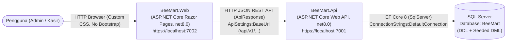

# Project Structure — BeeMart POS Web App

Dokumentasi struktur direktori dan berkas untuk solusi **BeeMart POS Web App** (.NET 8, ASP.NET Core) dengan arsitektur *Separation of Concerns* (`NFR-ARCH-001`, `NFR-ARCH-002`).

---

## 1. Architecture & Project Relationship Diagram

`BeeMart.Web` (WebClient) hanya bertindak sebagai *consumer* yang memanggil `BeeMart.Api` (Backend API) melalui HTTP/JSON (`ApiSettings:BaseUrl`). Seluruh logika bisnis dan akses database SQL Server melalui Entity Framework Core terpusat di `BeeMart.Api` (`ConnectionStrings:DefaultConnection`).



---

## 2. Directory Tree

Item yang sudah dibuat pada **Phase 1–6** (beserta *repository housekeeping*) ditandai sebagai **Active**, sedangkan item untuk fase berikutnya ditandai sebagai **Planned (Phase X)**.

```text
BeeMart/
├── .gitattributes                                   [Active - Repo Root]
├── .gitignore                                       [Active - Repo Housekeeping]
├── README.md                                        [Active - Repo Housekeeping]
├── BeeMart.sln                                      [Active - Phase 1]
├── PRD.md                                           [Active - Phase 0/1]
├── STRUCTURE.md                                     [Active - Phase 1-6]
├── CHANGELOG.md                                     [Active - Phase 1-6]
├── OPEN-ITEMS.md                                    [Active - Phase 1-6]
├── Database/                                        [Active - Phase 1]
│   ├── .gitkeep                                     [Active - Phase 1]
│   └── BeeMart.sql                                  [Active - Phase 2 (DDL) & Phase 3 (Seed DML)]
├── BeeMart.Api/                                     [Active - Phase 1]
│   ├── BeeMart.Api.csproj                           [Active - Phase 1 & Phase 5]
│   ├── Program.cs                                   [Active - Phase 1, Phase 4, Phase 5 & Phase 6]
│   ├── appsettings.json                             [Active - Phase 1, Phase 4 & Phase 5]
│   ├── appsettings.Development.json                 [Active - Phase 1]
│   ├── Properties/
│   │   └── launchSettings.json                      [Active - Phase 1]
│   ├── Controllers/                                 [Active - Phase 1 & Phase 6]
│   │   ├── .gitkeep                                 [Active - Phase 1]
│   │   ├── AuthController.cs                        [Active - Phase 6]
│   │   ├── ProductsController.cs                    [Planned (Phase 7)]
│   │   ├── PaymentMethodsController.cs              [Planned (Phase 7)]
│   │   └── TransactionsController.cs                [Planned (Phase 8-9)]
│   ├── Data/                                        [Active - Phase 4]
│   │   └── BeeMartDbContext.cs                      [Active - Phase 4]
│   ├── Models/                                      [Active - Phase 4 & Phase 6]
│   │   ├── Entities/                                [Active - Phase 4]
│   │   │   ├── MsUser.cs                            [Active - Phase 4]
│   │   │   ├── LtPaymentMethod.cs                   [Active - Phase 4]
│   │   │   ├── MsProduct.cs                         [Active - Phase 4]
│   │   │   ├── TrTransaction.cs                     [Active - Phase 4]
│   │   │   └── TrTransactionDetail.cs               [Active - Phase 4]
│   │   └── DTOs/                                    [Active - Phase 6 / Planned (Phase 7-9)]
│   │       └── Auth/                                [Active - Phase 6]
│   │           ├── LoginRequest.cs                  [Active - Phase 6]
│   │           ├── LoginResponse.cs                 [Active - Phase 6]
│   │           ├── RegisterRequest.cs               [Active - Phase 6]
│   │           └── RegisterResponse.cs              [Active - Phase 6]
│   └── Common/                                      [Active - Phase 5]
│       ├── ApiResponse.cs                           [Active - Phase 5]
│       ├── PasswordHasher.cs                        [Active - Phase 5]
│       ├── JwtTokenService.cs                       [Active - Phase 5]
│       └── ClaimsHelper.cs                          [Active - Phase 5]
└── BeeMart.Web/                                     [Active - Phase 1]
    ├── BeeMart.Web.csproj                           [Active - Phase 1]
    ├── Program.cs                                   [Active - Phase 1]
    ├── appsettings.json                             [Active - Phase 1]
    ├── appsettings.Development.json                 [Active - Phase 1]
    ├── Properties/
    │   └── launchSettings.json                      [Active - Phase 1]
    ├── Services/                                    [Planned (Phase 10)]
    │   └── ApiClient.cs                             [Planned (Phase 10)]
    ├── Pages/                                       [Active - Phase 1]
    │   ├── _ViewImports.cshtml                      [Active - Phase 1]
    │   ├── _ViewStart.cshtml                        [Active - Phase 1]
    │   ├── Index.cshtml                             [Active - Phase 1]
    │   ├── Index.cshtml.cs                          [Active - Phase 1]
    │   ├── Error.cshtml                             [Active - Phase 1]
    │   ├── Error.cshtml.cs                          [Active - Phase 1]
    │   ├── Shared/                                  [Active - Phase 1]
    │   │   └── _Layout.cshtml                       [Active - Phase 1 / Enhanced Phase 12]
    │   ├── Auth/                                    [Planned (Phase 11)]
    │   │   ├── Login.cshtml                         [Planned (Phase 11)]
    │   │   ├── Login.cshtml.cs                      [Planned (Phase 11)]
    │   │   ├── Register.cshtml                      [Planned (Phase 11)]
    │   │   └── Register.cshtml.cs                   [Planned (Phase 11)]
    │   └── Transaction/                             [Planned (Phase 13-14)]
    │       ├── New.cshtml                           [Planned (Phase 13)]
    │       ├── New.cshtml.cs                        [Planned (Phase 13)]
    │       ├── History.cshtml                       [Planned (Phase 14)]
    │       └── History.cshtml.cs                    [Planned (Phase 14)]
    └── wwwroot/                                     [Active - Phase 1]
        ├── favicon.ico                              [Active - Phase 1]
        ├── css/
        │   └── site.css                             [Active - Phase 1 (Empty) / Populated Phase 10]
        └── js/
            └── site.js                              [Active - Phase 1 / Enhanced Phase 10-14]
```

---

## 3. Detailed Inventory of Existing Folders & Files (Phase 1–6)

### 3.1 Solution Root (`BeeMart/`)
| Path | Project / Scope | Purpose (Fungsi) | Connections & Dependencies |
| :--- | :--- | :--- | :--- |
| `.gitattributes` | Repository Root | Konfigurasi normalisasi baris teks Git (`* text=auto`). | Digunakan oleh Git pada seluruh file di repositori. |
| `.gitignore` | Repository Root | Aturan pengabaian file Git standar Visual Studio / .NET (`bin/`, `obj/`, `.vs/`, `*.user`, `*.suo`, `*.log`, `TestResults/`, `*.mdf`, `*.ldf`, `scratch/`), dengan pengecualian eksplisit agar `launchSettings.json` dan `appsettings.Development.json` tetap terlacak. | Menjaga kebersihan repositori Git dari artefak kompilasi dan file sementara. |
| `README.md` | Repository Root | Panduan utama repositori yang memuat deskripsi proyek BeeMart POS, *tech stack*, tata letak direktori, langkah instalasi database & aplikasi, tabel akun *seed* pengembangan, serta status pengerjaan per fase. | Merujuk ke `Database/BeeMart.sql`, `BeeMart.Api/appsettings.json`, `STRUCTURE.md`, `OPEN-ITEMS.md`, `CHANGELOG.md`, dan `PRD.md`. |
| `BeeMart.sln` | Solution Root | File Solution Visual Studio / .NET yang menggabungkan proyek Backend API dan WebClient (`DELIV-003`). | Mereferensikan `BeeMart.Api/BeeMart.Api.csproj` dan `BeeMart.Web/BeeMart.Web.csproj`. |
| `PRD.md` | Solution Root | Dokumen spesifikasi kebutuhan produk (*Product Requirements Document*) BeeMart POS. | Menjadi acuan arsitektur, ERD database, endpoint API, dan aturan bisnis seluruh proyek. |
| `STRUCTURE.md` | Solution Root | Dokumentasi struktur direktori, fungsi setiap file, serta relasi antar komponen. | Mendokumentasikan `BeeMart.sln`, `BeeMart.Api`, `BeeMart.Web`, `Database/`, dan file tingkat repositori. |
| `CHANGELOG.md` | Solution Root | Catatan riwayat perubahan (*changelog*) per fase pengerjaan dan pemeliharaan repositori. | Mencatat perubahan pada seluruh file di dalam `BeeMart/`. |
| `OPEN-ITEMS.md` | Solution Root | Daftar *checklist* tugas per fase (Phase 1–15), *checklist* pemeliharaan repositori, serta catatan keputusan/asumsi teknis. | Berhubungan dengan rencana pengerjaan di `PRD.md` dan `CHANGELOG.md`. |
| `Database/` | Solution Root | Direktori khusus penyimpanan script SQL database (`DELIV-004`). | Menampung `Database/BeeMart.sql` dan `Database/.gitkeep`. |
| `Database/.gitkeep` | Solution Root | Penanda agar folder `Database/` tetap terlacak di Git. | Dipertahankan di dalam folder `Database/` bersama `Database/BeeMart.sql`. |
| `Database/BeeMart.sql` | Solution Root (`Database/`) | Script T-SQL SQL Server *idempotent* (re-runnable) berisi: (1) **Phase 2 DDL** pembuatan database `BeeMart`, 5 tabel (`LtPaymentMethod`, `MsUser`, `MsProduct`, `TrTransaction`, `TrTransactionDetail`), 4 indeks Section 5.4, serta *primary key*, *foreign key*, *unique*, *check*, dan *default constraints* bernama eksplisit; dan (2) **Phase 3 DML Seed Data** berpelindung `IF NOT EXISTS` / `WHERE NOT EXISTS` untuk 3 metode pembayaran (`LtPaymentMethod`), 6 pengguna dengan *BCrypt password hash* (`MsUser`), dan 22 produk dengan GUID tetap (`MsProduct`: 12 produk `Apel`, 4 produk `Susu`, 6 produk sembako lainnya) (`DELIV-004`). | Dieksekusi di SQL Server (`localhost\SQLEXPRESS`), dan skema serta data awalnya dipetakan secara presisi oleh `BeeMartDbContext` beserta 5 entitas EF Core di `BeeMart.Api` (Phase 4). |

### 3.2 Backend API Project (`BeeMart.Api/`)
| Path | Project | Purpose (Fungsi) | Connections & Dependencies |
| :--- | :--- | :--- | :--- |
| `BeeMart.Api/` | `BeeMart.Api` | Folder utama proyek Backend RESTful API (`DELIV-002`, `NFR-ARCH-001`). | Terdaftar di `BeeMart.sln`; dipanggil oleh `BeeMart.Web` melalui HTTP JSON. |
| `BeeMart.Api/BeeMart.Api.csproj` | `BeeMart.Api` | File definisi proyek C# (`Microsoft.NET.Sdk.Web`) dengan target `net8.0`. | Memuat referensi paket NuGet EF Core 8 (`Microsoft.EntityFrameworkCore.SqlServer`, `.Design`, `.Tools` v8.0.32), `BCrypt.Net-Next` (v4.0.3), dan `Microsoft.AspNetCore.Authentication.JwtBearer` (v8.0.13). |
| `BeeMart.Api/Program.cs` | `BeeMart.Api` | Titik masuk (*entry point*) aplikasi Backend API, registrasi `BeeMartDbContext` (`UseSqlServer("DefaultConnection")`), registrasi DI layanan fondasi (`IPasswordHasher`, `IJwtTokenService`), konfigurasi autentikasi JWT Bearer (`JwtBearerDefaults.AuthenticationScheme` & `TokenValidationParameters`), konfigurasi `SuppressModelStateInvalidFilter = true` pada `AddControllers()`, dan pipeline HTTP middleware (`UseAuthentication`, `UseAuthorization`, `MapControllers`). | Membaca konfigurasi `DefaultConnection` dan `JwtSettings` dari `BeeMart.Api/appsettings.json`, mendaftarkan `BeeMartDbContext`, `PasswordHasher`, dan `JwtTokenService`, serta memetakan route ke `Controllers/`. |
| `BeeMart.Api/appsettings.json` | `BeeMart.Api` | File konfigurasi utama Backend API yang menyimpan connection string SQL Server `DefaultConnection` (`Server=localhost\SQLEXPRESS;Database=BeeMart;Trusted_Connection=True;TrustServerCertificate=True;`) dan pengaturan `JwtSettings` (`SecretKey`, `Issuer`, `Audience`, `ExpiryMinutes`). | Dibaca oleh `Program.cs` dan `JwtTokenService` untuk menginisialisasi `BeeMartDbContext` serta pembuatan/validasi token JWT. |
| `BeeMart.Api/appsettings.Development.json` | `BeeMart.Api` | Konfigurasi spesifik environment `Development` (level logging). | Meng-override `BeeMart.Api/appsettings.json` saat `ASPNETCORE_ENVIRONMENT=Development`. |
| `BeeMart.Api/Properties/launchSettings.json` | `BeeMart.Api` | Pengaturan profil eksekusi lokal dan port tetap Backend API (`https://localhost:7001`, `http://localhost:5001`). | Port `https://localhost:7001` disinkronkan dengan `ApiSettings:BaseUrl` pada `BeeMart.Web/appsettings.json`. |
| `BeeMart.Api/Data/BeeMartDbContext.cs` | `BeeMart.Api` | Kelas `DbContext` EF Core (`BeeMartDbContext`) yang mengekspos `DbSet` (`Users`, `PaymentMethods`, `Products`, `Transactions`, `TransactionDetails`) dan mengonfigurasi pemetaan tabel, tipe data/presisi `decimal`, batas panjang `NVARCHAR`, indeks unik/non-unik, serta relasi *foreign key* (`DeleteBehavior.Restrict`) melalui Fluent API di `OnModelCreating`. | Diregistrasikan di `BeeMart.Api/Program.cs` dan memetakan 5 kelas entitas di `BeeMart.Api/Models/Entities/` ke skema SQL `Database/BeeMart.sql`. |
| `BeeMart.Api/Models/Entities/MsUser.cs` | `BeeMart.Api` | Entitas POCO untuk tabel `dbo.MsUser` (`IdUser`, `Username`, `FullName`, `PasswordHash`, `Role`, kolom audit `Stsrc`/`DateIn`/`UserIn`/`Dateup`/`Userup`, dan koleksi navigasi `Transactions`). | Dipetakan oleh `BeeMartDbContext`; berelasi `1:N` dengan `TrTransaction`. |
| `BeeMart.Api/Models/Entities/LtPaymentMethod.cs` | `BeeMart.Api` | Entitas POCO untuk tabel `dbo.LtPaymentMethod` (`IdPaymentMethod`, `MethodName`, kolom audit, dan koleksi navigasi `Transactions`). | Dipetakan oleh `BeeMartDbContext`; berelasi `1:N` dengan `TrTransaction`. |
| `BeeMart.Api/Models/Entities/MsProduct.cs` | `BeeMart.Api` | Entitas POCO untuk tabel `dbo.MsProduct` (`IdProduct`, `Name`, `Weight`, `Stock`, `Price`, `Discount`, kolom audit, dan koleksi navigasi `TransactionDetails`). | Dipetakan oleh `BeeMartDbContext`; berelasi `1:N` dengan `TrTransactionDetail`. |
| `BeeMart.Api/Models/Entities/TrTransaction.cs` | `BeeMart.Api` | Entitas POCO untuk tabel header transaksi `dbo.TrTransaction` (`IdTransaction`, `InvoiceNo`, `TransactionDate`, `IdUser`, `IdPaymentMethod`, properti `[NotMapped] TotalItem`, `TotalPrice`, kolom audit, serta navigasi `User`, `PaymentMethod`, dan `TransactionDetails`). | Dipetakan oleh `BeeMartDbContext`; berelasi `N:1` ke `MsUser` & `LtPaymentMethod`, serta `1:N` ke `TrTransactionDetail`. |
| `BeeMart.Api/Models/Entities/TrTransactionDetail.cs` | `BeeMart.Api` | Entitas POCO untuk tabel rincian transaksi `dbo.TrTransactionDetail` (`IdTransactionDetail`, `IdTransaction`, `IdProduct`, `Qty`, `Price`, `Discount`, `SubTotal`, kolom audit, serta navigasi `Transaction` dan `Product`). | Dipetakan oleh `BeeMartDbContext`; berelasi `N:1` ke `TrTransaction` dan `MsProduct`. |
| `BeeMart.Api/Models/DTOs/Auth/LoginRequest.cs` | `BeeMart.Api` | DTO request untuk endpoint `POST /api/v1/auth/login` (`Username`, `Password`, `Role`). | Digunakan oleh `AuthController.Login`. |
| `BeeMart.Api/Models/DTOs/Auth/LoginResponse.cs` | `BeeMart.Api` | DTO response data untuk endpoint `POST /api/v1/auth/login` (`IdUser`, `Username`, `FullName`, `Role`, `Token`). | Dibungkus di dalam `ApiResponse<LoginResponse>` oleh `AuthController.Login`. |
| `BeeMart.Api/Models/DTOs/Auth/RegisterRequest.cs` | `BeeMart.Api` | DTO request untuk endpoint `POST /api/v1/auth/register` (`Username`, `FullName`, `Password`, `RePassword`, `Role`). | Digunakan oleh `AuthController.Register`. |
| `BeeMart.Api/Models/DTOs/Auth/RegisterResponse.cs` | `BeeMart.Api` | DTO response data untuk endpoint `POST /api/v1/auth/register` (`IdUser`, `Username`, `FullName`, `Role`). | Dibungkus di dalam `ApiResponse<RegisterResponse>` oleh `AuthController.Register`. |
| `BeeMart.Api/Common/ApiResponse.cs` | `BeeMart.Api` | Model pembungkus respons JSON standar (`ApiResponse<T>` dan `ApiResponse`) sesuai `PRD.md` Section 6.2 dengan properti `status` (`"success"` atau `"error"`), `message`, `data`, serta *factory methods* (`Success`, `Error`). | Digunakan oleh seluruh endpoint controller di `BeeMart.Api/Controllers/` (Phase 6–9). |
| `BeeMart.Api/Common/PasswordHasher.cs` | `BeeMart.Api` | Antarmuka `IPasswordHasher` dan implementasi `PasswordHasher` berbasis `BCrypt.Net-Next` (work factor `11`) untuk melakukan *hashing* password baru dan verifikasi password terhadap `MsUser.PasswordHash`. | Diregistrasikan sebagai Singleton di `BeeMart.Api/Program.cs`; kompatibel penuh dengan 6 akun *seed* di `Database/BeeMart.sql`. |
| `BeeMart.Api/Common/JwtTokenService.cs` | `BeeMart.Api` | Antarmuka `IJwtTokenService` dan implementasi `JwtTokenService` menggunakan algoritma HMAC-SHA256 (`HmacSha256`) untuk menerbitkan token JWT yang memuat klaim pengguna (`idUser`, `username`, `fullName`, `role`). | Membaca `JwtSettings` dari `BeeMart.Api/appsettings.json`; diregistrasikan di `BeeMart.Api/Program.cs`. |
| `BeeMart.Api/Common/ClaimsHelper.cs` | `BeeMart.Api` | Kelas *extension methods* statis pada `ClaimsPrincipal` (`GetUserId`, `GetUsername`, `GetFullName`, `GetRole`, `IsAdmin`, `IsCashier`) beserta konstanta nama klaim dan role. | Digunakan oleh `JwtTokenService` dan controller berotorisasi di `BeeMart.Api/Controllers/` (Phase 6–9). |
| `BeeMart.Api/Controllers/` | `BeeMart.Api` | Direktori untuk menyimpan kelas-kelas API Controller ber-versioning `/api/v1/...`. | Dipetakan oleh `app.MapControllers()` di `BeeMart.Api/Program.cs`. |
| `BeeMart.Api/Controllers/.gitkeep` | `BeeMart.Api` | Penanda agar direktori `Controllers/` tetap ada setelah penghapusan *boilerplate* `WeatherForecastController.cs`. | Dipertahankan di dalam `BeeMart.Api/Controllers/`. |
| `BeeMart.Api/Controllers/AuthController.cs` | `BeeMart.Api` | Controller autentikasi publik (`[Route("api/v1/auth")]`, `[AllowAnonymous]`) yang menyediakan endpoint `POST /api/v1/auth/register` (`API-AUTH-02`, validasi input, password match, role, keunikan username *case-insensitive*, generasi `IdUser` 5 digit `D5`, hashing BCrypt) dan `POST /api/v1/auth/login` (`API-AUTH-01`, verifikasi user aktif, role, BCrypt hash, dan penerbitan JWT token). | Menginjeksi `BeeMartDbContext`, `IPasswordHasher`, dan `IJwtTokenService`, serta menggunakan DTO di `BeeMart.Api/Models/DTOs/Auth/` dan pembungkus `ApiResponse<T>`. |

### 3.3 WebClient Project (`BeeMart.Web/`)
| Path | Project | Purpose (Fungsi) | Connections & Dependencies |
| :--- | :--- | :--- | :--- |
| `BeeMart.Web/` | `BeeMart.Web` | Folder utama proyek Frontend/UI WebClient (`DELIV-001`, `NFR-ARCH-001`, `NFR-ARCH-002`). | Terdaftar di `BeeMart.sln`; hanya berkomunikasi dengan `BeeMart.Api` melalui HTTP Request (tanpa akses database langsung). |
| `BeeMart.Web/BeeMart.Web.csproj` | `BeeMart.Web` | File definisi proyek C# (`Microsoft.NET.Sdk.Web`) dengan target `net8.0` tanpa paket EF Core maupun driver database. | Hanya bergantung pada SDK Web standar `.NET 8`. |
| `BeeMart.Web/Program.cs` | `BeeMart.Web` | Titik masuk (*entry point*) aplikasi WebClient Razor Pages, konfigurasi layanan (`AddRazorPages`), dan middleware (`UseStaticFiles`, `UseRouting`, `MapRazorPages`). | Membaca konfigurasi `ApiSettings:BaseUrl` dari `BeeMart.Web/appsettings.json` dan menyajikan halaman dari `Pages/` serta aset dari `wwwroot/`. |
| `BeeMart.Web/appsettings.json` | `BeeMart.Web` | File konfigurasi utama WebClient yang menyimpan `ApiSettings:BaseUrl` (`https://localhost:7001/api/v1/`). Tidak memiliki connection string (`NFR-ARCH-002`). | Menunjuk langsung ke alamat port HTTPS `BeeMart.Api` (`https://localhost:7001/api/v1/`). |
| `BeeMart.Web/appsettings.Development.json` | `BeeMart.Web` | Konfigurasi logging untuk environment `Development` pada WebClient. | Meng-override `BeeMart.Web/appsettings.json` saat `ASPNETCORE_ENVIRONMENT=Development`. |
| `BeeMart.Web/Properties/launchSettings.json` | `BeeMart.Web` | Pengaturan profil eksekusi lokal dan port tetap WebClient (`https://localhost:7002`, `http://localhost:5002`). | Menggunakan port berbeda dari `BeeMart.Api` agar kedua proyek dapat berjalan bersamaan. |
| `BeeMart.Web/Pages/` | `BeeMart.Web` | Direktori halaman Razor Pages (`.cshtml` dan `.cshtml.cs`). | Dirender oleh engine Razor Pages yang dikonfigurasi di `BeeMart.Web/Program.cs`. |
| `BeeMart.Web/Pages/_ViewImports.cshtml` | `BeeMart.Web` | Deklarasi namespace dan Tag Helpers (`Microsoft.AspNetCore.Mvc.TagHelpers`) yang berlaku bagi seluruh Razor Pages. | Digunakan oleh seluruh file `.cshtml` di dalam `BeeMart.Web/Pages/`. |
| `BeeMart.Web/Pages/_ViewStart.cshtml` | `BeeMart.Web` | Menetapkan layout default (`_Layout`) untuk seluruh halaman Razor. | Menghubungkan halaman-halaman di `Pages/` dengan `Pages/Shared/_Layout.cshtml`. |
| `BeeMart.Web/Pages/Shared/` | `BeeMart.Web` | Direktori komponen tampilan dan layout bersama (*shared views*). | Diakses oleh seluruh halaman Razor di `BeeMart.Web/Pages/`. |
| `BeeMart.Web/Pages/Shared/_Layout.cshtml` | `BeeMart.Web` | Kerangka HTML utama bebas Bootstrap (`FE-STYLE-001`). | Memuat `/css/site.css` dan `/js/site.js` dari `wwwroot/`, serta merender konten halaman melalui `@RenderBody()`. |
| `BeeMart.Web/Pages/Index.cshtml` & `Index.cshtml.cs` | `BeeMart.Web` | Halaman beranda awal (`/`), telah dibersihkan dari class CSS Bootstrap. | Menggunakan `_Layout.cshtml`; nantinya akan mengarahkan pengguna ke halaman Login atau New Transaction (Phase 10–11). |
| `BeeMart.Web/Pages/Error.cshtml` & `Error.cshtml.cs` | `BeeMart.Web` | Halaman penanganan *exception* standar bebas class Bootstrap. | Dipanggil oleh middleware `app.UseExceptionHandler("/Error")` di `BeeMart.Web/Program.cs`. |
| `BeeMart.Web/wwwroot/` | `BeeMart.Web` | Direktori root file statis yang disajikan ke browser oleh `app.UseStaticFiles()`. | Diakses oleh `_Layout.cshtml` dan halaman Razor lainnya. |
| `BeeMart.Web/wwwroot/favicon.ico` | `BeeMart.Web` | Ikon tab browser untuk aplikasi WebClient. | Disajikan secara statis dari `wwwroot/`. |
| `BeeMart.Web/wwwroot/css/` | `BeeMart.Web` | Direktori file stylesheet CSS kustom. | Direferensikan oleh `Pages/Shared/_Layout.cshtml`. |
| `BeeMart.Web/wwwroot/css/site.css` | `BeeMart.Web` | File CSS murni (saat ini dikosongkan pada Phase 1 sesuai instruksi, bebas Bootstrap). | Direferensikan oleh `Pages/Shared/_Layout.cshtml`; akan diisi styling POS murni pada Phase 10. |
| `BeeMart.Web/wwwroot/js/` | `BeeMart.Web` | Direktori script JavaScript sisi klien. | Direferensikan oleh `Pages/Shared/_Layout.cshtml`. |
| `BeeMart.Web/wwwroot/js/site.js` | `BeeMart.Web` | File JavaScript kustom sisi klien. | Direferensikan oleh `Pages/Shared/_Layout.cshtml`; akan diisi utilitas UI/interaksi pada Phase 10–14. |

---

## 4. Planned Items by Phase (Phase 7 – Phase 15)

| Planned Path | Target Project / Folder | Planned Phase | Purpose |
| :--- | :--- | :---: | :--- |
| `BeeMart.Api/Controllers/PaymentMethodsController.cs` & `ProductsController.cs` | `BeeMart.Api` | Phase 7 | Endpoint `/api/v1/payment-methods` dan `/api/v1/products/search`. |
| `BeeMart.Api/Controllers/TransactionsController.cs` | `BeeMart.Api` | Phase 8–9 | Endpoint `/api/v1/transactions/next-invoice`, `POST /api/v1/transactions`, dan `GET /api/v1/transactions/history`. |
| `BeeMart.Web/Services/*` & `Helpers/*` | `BeeMart.Web` | Phase 10 | HTTP API Client (`HttpClient` ke `ApiSettings:BaseUrl`), manajemen sesi/token, route guard, dan formatter Rupiah/waktu lokal. |
| `BeeMart.Web/Pages/Auth/Login.cshtml(.cs)` & `Register.cshtml(.cs)` | `BeeMart.Web` | Phase 11 | Halaman autentikasi `BeeMart Login` dan `Register Akun`. |
| `BeeMart.Web/Pages/Shared/_Layout.cshtml` | `BeeMart.Web` | Phase 12 | Pembaruan layout utama POS dengan Header biru (`BeeMart`, jam real-time / info role & login, tombol `Logout`) dan tab navigasi. |
| `BeeMart.Web/Pages/Transaction/New.cshtml(.cs)` | `BeeMart.Web` | Phase 13 | Halaman kasir `New Transaction` (Invoice otomatis, cari barang maks 10, dialog pilih & validasi stok, keranjang belanja, metode pembayaran dinamis, submit). |
| `BeeMart.Web/Pages/Transaction/History.cshtml(.cs)` | `BeeMart.Web` | Phase 14 | Halaman `History Transaction` untuk role `Cashier` (hanya transaksi sendiri) dan `Admin` (semua kasir) dengan filter tanggal wajib, urutan ascending, dan pagination maks 20 baris. |
